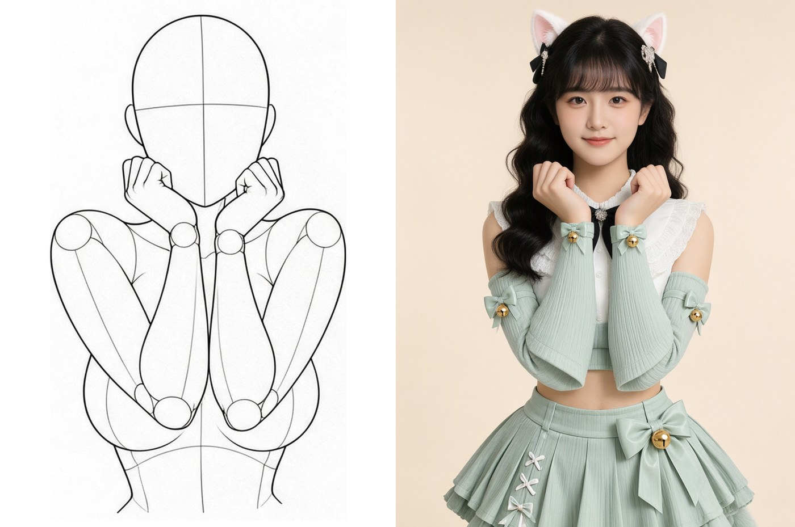

# comfyui-ref-lookbook · 参考图册

ComfyUI 节点包：把六套公开的 AI 参考素材（服装 / 服装动画 / 姿势 / 脸 / 深度姿势 / 二次元）收进图库节点，任选组合出图；另附一个独立的澪设计档案库（作者原版提示词）。**仓库只发代码、索引与内置缩略图，原图运行时按单张获取。**

A ComfyUI node pack that turns six public AI-reference libraries into galleries you can compose a single image from.

| 库 | 节点 | 记录 | 图片 | 分类 / 编号 |
| --- | --- | --- | --- | --- |
| 服装 | `CostumeGallery` | 1,407 套 | 1,407 张 | 春 / 夏 / 秋 / 冬装 / 内衣 / 派对 / 泳装 / 性感；`SPR-0001` … |
| 服装动画 | `CostumeAnimeGallery` | 1,320 套 | 1,320 张 | 同服装 8 个分类，动漫画风；`SPR-0001` … |
| 姿势 | `PoseGallery` | 288 个动作 | 1,439 张（5 机位） | 性感系 / 标准系 / 上半身 / 双人；`POS-SEXY-P001` … |
| 脸部 | `FaceGallery` | 1,498 张 | 1,498 张 | 脸部特写 × 短 / 中 / 中长 / 长发；`FACE-0001` … |
| 深度姿势 | `DepthGallery` | 288 个动作 | 1,439 张（5 机位） | 与姿势同批动作的灰度深度图；`DEP-SEXY-P001` … |
| 二次元 | `AnimeGallery` | 1,027 组 | 1,308 张 | 发型与眼睛 / 服装 / 姿势（姿势另有线稿）；`ANE-H001` … |
| 澪设计档案 | `MioGallery` | 387 件（43 卷） | 387 张（418 px） | 发型 6 卷 / 服装 13 卷 / 姿势 24 卷；`H-01-01` … |

合计 **5,828 条记录、8,411 张参考图**。六库互不依赖，可固定脸换装、固定装换脸、只换衣服做对比。

- **深度库**与姿势库是同一批 288 个动作、文件名一一对应（`POS-` ↔ `DEP-`），可直接接 ControlNet depth。
- **服装动画**与服装库同分类、同编号规则但画风不同，各自独立编号——**同一编号在两库是两张不同的图**。
- **二次元**把三组混在一个库里（编号前缀 `H` / `O` / `P`），姿势另有线稿版。
- **澪设计档案不属于六库**、不占六库页签，走独立页面。每卷 9 件，带作者中英文提示词；源站只有 418 px 一档，定位是「参考 + 提示词」，要高清就用它的 prompt 重绘。

不属于六库的节点：`CharacterRecipe`（四合一角色配方：发型 + 脸 + 服装 + 姿势一次取图，输出四张图 + 参考拼图 + 中英提示词）、`HairGallery`（发型图库：澪设计 54 件 / 二次元 230 条，一个下拉切来源）、`MioGallery`（澪设计单取一件）、`PromptJoin`（提示词拼接：静态模板 + 最多两路动态文字）。

当前版本 **v1.10.0**，变化见[更新日志](更新日志.md)。

## 安装

```bash
cd ComfyUI/custom_nodes
git clone https://github.com/YaJing0412/comfyui-ref-lookbook.git
```

重启 ComfyUI，浏览器 `Ctrl+Shift+R`。无额外依赖（用 ComfyUI 自带的 Pillow / aiohttp）。

## 不开 ComfyUI 单独用

插件根目录自带零依赖独立服务（只用 Python 标准库），浏览体验与 ComfyUI 内一致：

```bash
python server.py            # http://127.0.0.1:8180/ref_lookbook/gallery
```

Windows 可直接双击 `start_gallery.bat`。

| 参数 | 默认 | 说明 |
| --- | --- | --- |
| `--port` | `8180` | 监听端口 |
| `--host` | `127.0.0.1` | 监听地址；改 `0.0.0.0` 会对局域网开放，启动时打印安全提醒 |
| `--library` | 插件内 `library/` | 换图库根目录（需含 `data/` 与六个库子目录） |
| `--export-dir` | 插件内 `exports/` | 「导入」落盘目录（独立模式没有 ComfyUI 的 `input/`） |

与 ComfyUI 模式共用同一份 `library/`，两种启动方式互相通用。`GET /ref_lookbook/status` 可自检各库计数与缓存。

## 用法

1. 添加节点：`image → Reference Gallery → 服装 / 服装动画 / 姿势 / 脸部 / 深度姿势 / 二次元 / 发型`，以及四合一角色配方、提示词拼接。
2. 点「浏览…图库」开弹窗（点节点上的预览图也行）：一级「日系图库 / 澪图库」，二级页签切库，三级分类再筛；支持中英日关键词与编号搜索（空格分隔＝同时包含）。
3. **服装 / 姿势节点也能用澪图库的素材**：弹窗顶部点「澪图库」，选 `C-01-01` / `P-01-01` 会原样写回，预览与出图跟着编号切库；类别不对（例如服装节点里选发型）会留在弹窗提示，不会静默关掉装作成功。
4. 卡片看大图，「使用此素材 → ComfyUI」写回编号（姿势同时写 `angle`，二次元同时写 `variant`）。也可直接开 `?lib=pose&id=POS-SEXY-P001&angle=斜45°` 定位。
5. 姿势与深度姿势可切五个机位（正面 / 俯视 / 仰视 / 侧面 / 斜 45°）；二次元可切彩图 / 线稿（线稿只覆盖姿势组）。
6. 任意原生「加载图像」节点也能调图库：选中后原图落到 `ComfyUI/input/ref_<编号>.png` 并自动填好；服装动画库带库前缀（`ref_anime-SPR-0001.png`），两库同编号可共存。
7. 深度姿势库直接接 `ControlNetApplyAdvanced` 的 `image`，**不要再过 depth 预处理器**（它本来就是深度图）。
8. 澪设计档案走独立页面 `/ref_lookbook/mio`：版式与六库页一致（一级菜单 / 系列页签 / 卷条），点作品看大图与两个提示词，各带「复制」。`#all` / `#s-hair` / `#hair-01` 可定位。


## 示例工作流

**只有一个文件**：[ref_gallery_qwen21.json](example_workflows/ref_gallery_qwen21.json)（31 KB），拖进画布即可。同一套模型加载与采样，并排放两条出图链：

| 分组 | 取素材方式 | 适合 |
| --- | --- | --- |
| ① 单独节点（上方） | 发型 / 脸部 / 服装 / 姿势 四个图库节点各点一次 | 逐张换、逐张对比 |
| ② 四合一配方（下方） | `CharacterRecipe` 一个节点四行点完，提示词自动拼好 | 常规出图 |

参考图顺序两边一致，**固定不能交换**：`image_1` 姿势定动作与构图、`image_2` 脸定身份、`image_3` 服装定穿着、`image_4` 发型定头顶造型。

两条链的提示词都是**中文**，想改直接在节点里改。① 那条由 `Prompt Join 提示词拼接` 汇成两段：中文分工说明 + 所选发型的文字描述（`hair_detail`）。后者是发型能否压住脸参考的关键——只给模型看一张白色人台照片时，长发选长发容易画回图 2 自带的头发，写成字才稳。

两条链各自成组，直接点运行会两条一起跑。画布最上方有**「示例开关」**：点「①」则 ② 整组静音，点「②」反过来；单选，再点当前那组不会两组全关，状态随工作流存盘，默认只跑 ①。它是纯前端节点，不进执行队列、不占额外依赖。

> 开关是纯前端节点，**升级插件后要先刷新页面（F5）**才会加载到新类型。没刷新会提示「缺少节点包 `ref_lookbook/WorkflowSwitch`」、画布上只剩一个空紫框。自查：控制台执行 `LiteGraph.registered_node_types["ref_lookbook/WorkflowSwitch"]`，有值即已加载。

不需要任何额外插件。想用自己的照片当脸，画布右上有一张空的 `Load Image`，把 `image_2` 那根线拖过去即可。四张参考的分工、发型两个来源、提示词切法与深度模式见[使用指南](example_workflows/ref_gallery_qwen21.md)。

| 线稿人偶 + 脸 + 服装 + 发型 → 成图 | 四张参考 → 成图（四合一配方） |
| --- | --- |
|  |  |

## 依赖模型

只用 ComfyUI 内置节点。四个模型自行准备，放好后重启 ComfyUI：

| 文件 | 放到 | 大小 |
| --- | --- | --- |
| `qwen_image_2.1_int8_convrot.safetensors` | `models/diffusion_models/` | 6.8 GB |
| `qwen3vl_8b_int8_convrot.safetensors` | `models/text_encoders/` | 8.7 GB |
| `qwen_image_2.1_vae_bf16.safetensors` | `models/vae/` | 644 MB |
| `VNCCS_QI2_PoseStudioV2.safetensors` | `models/loras/` 根目录 | 152 MB |

LoRA 是 AHEKOT 的 VNCCS PoseStudio Qwen Image 2.1 v2.0：[Civitai](https://civitai.com/models/2957080/vnccs-posestudio-qwen-image-21) 或 [HuggingFace](https://huggingface.co/MIUProject/VNCCS_PoseStudio_QI2.1)（HF 文件名尾部带空格，下载后去掉）。用 `LoraLoaderModelOnly` 加载，不需要 `ComfyUI_VNCCS_Utils`。

## 节点输出

所有图库节点通用：`image`（PNG 原图，RGB，透明区域合成白底）、`width` / `height`、`<库>_id`、`description`（分类 + 二级分类 + 中文关键词），有则给 `keywords_en` / `description_ja`。

四个可选参数（默认等于旧行为，老工作流不受影响）：

| 参数 | 默认 | 说明 |
| --- | --- | --- |
| `resize_mode` | 原图尺寸 | 可换「指定尺寸（居中裁剪）」「指定尺寸（留白填充）」 |
| `width` / `height` | 1024 / 1280 | 仅指定尺寸模式生效，8 的倍数，64–8192 |
| `flip_horizontal` | 否 | 水平翻转，人物朝左 / 朝右互换 |

各节点差异：

- `MioGallery`：多 `prompt` / `prompt_zh`（作者原版英文 / 中文提示词）。
- `HairGallery`：多 `prompt` / `prompt_zh`（澪设计取作者原句，二次元取关键词）与 `hair_detail`（只讲头发形状的描述，供提示词拼接）。
- `CharacterRecipe`：输出 `face_image` / `costume_image` / `pose_image` / `hair_image`（已统一尺寸）、`reference_sheet`（四张横拼，间隔 12 px 白底）、`width` / `height`、`prompt_zh` / `prompt_en`。另有 `style_preset`、`costume_library`、`use_depth`（姿势取同编号深度图）、`hair_source`、`pose_angle`。**`hair_image` 排在输出末尾**——连线按序号存，插中间会让老图整体错位。
- `PromptJoin`：把静态 `text` 与 `extra` / `extra2` 按序合并，空值跳过。

姿势 / 深度节点另有 `angle` 下拉，二次元有 `variant` 下拉。这些节点只提供参考图，本身不换装、不换脸。

## 图片怎么来

**缩略图**随仓库内置（8,411 张 WebP，约 60 MB），离线可完整浏览：前三库取自 [ai-ref-library-cn](https://github.com/sleepy-zone/ai-ref-library-cn) 的内嵌缩略图（200×250，未改动），深度与二次元统一转 360 px WebP，服装动画源站本身是 360×540，原样落盘。

**原图不进仓库**（体积大、上游禁止再分发），运行时按文件名取一次：

| 库 | 原图地址 |
| --- | --- |
| 服装 | `ai-costume-gallery.pages.dev/png/<文件名>.png` |
| 服装动画 | `ai-costume-anime-gallery.pages.dev/png/<文件名>.png` |
| 姿势 | `ai-pose-gallery.pages.dev/img/<文件名>.png` |
| 脸部 | `ai-portrait-gallery.pages.dev/img/full/<文件名>.png` |
| 深度姿势 | `ai-pose-depth-gallery.pages.dev/img/<文件名>.png` |
| 二次元 | `charadb-2fi.pages.dev/img/<文件名>.jpg`（线稿为 `line/*.png`） |

**澪设计档案例外**：源站没有更高清版本，387 张 JPEG（约 9 MB）直接内置在 `library/mio/thumbs/`，节点的「原图」也指向同一文件——不重复存、也不降质转码。

取图逻辑（`catalog.ensure_original`）：本机 `library/<库>/png/` 有就读，不联网 → 没有则取一次，先写 `.part` 再原子替换，校验文件头挡错误页和半截文件 → 失败时报错，带完整地址与应放位置。只有「看大图」和「节点出图」会取原图，共用同一份缓存；并发受限（缩略图 8 / 原图 12，12 是实测吞吐拐点）。

想完全离线：按 `library/data/*-zh.json` 的「原图」字段把文件放到 `library/<库>/png/`，再设 `COMFYUI_REF_LOOKBOOK_OFFLINE=1`。

## 目录结构

```text
comfyui-ref-lookbook/
├── library/
│   ├── data/            # 索引、分类与元数据（约 3.9 MB）
│   ├── {costume,costume-anime,pose,face,depth,anime}/{thumbs,png,img}/
│   ├── mio/{thumbs,png}/  # 平铺库：原图 = 缩略图同一份
│   └── SOURCE.json      # 素材版本、数量与上游地址模板
├── web/                 # ComfyUI 扩展 + 一份 style.css 撑起六库页与澪图库页
├── server.py            # 独立 HTTP 服务（start_gallery.bat 双击启动）
├── example_workflows/   # 示例工作流 + 说明 + 效果图
├── licenses/            # 上游参考项目的许可原文
└── tests/               # 136 个 Python 测试 + 22 个前端测试
```

`<库>/thumbs/` 内置；`<库>/png/`、`<库>/img/` 进 `.gitignore`，只留 `.gitkeep`。看过的图、出过的图落进对应目录后不再下载。

## 环境变量

| 变量 | 默认 | 作用 |
| --- | --- | --- |
| `COMFYUI_REF_LOOKBOOK_LIBRARY` | 节点内 `library/` | 换图库根目录，需含 `data/` 与六个库子目录 |
| `COMFYUI_REF_LOOKBOOK_OFFLINE` | 未设 | `1` = 只用本地图片，缺图提示地址，永不联网 |
| `COMFYUI_REF_LOOKBOOK_TIMEOUT` | `60` | 单次下载超时（秒） |
| `COMFYUI_REF_LOOKBOOK_THUMB_WIDTH` | `360` | 缩略图缓存宽度 |
| `COMFYUI_REF_LOOKBOOK_THUMB_WORKERS` | `8` | 缩略图并发上限 |
| `COMFYUI_REF_LOOKBOOK_ORIGIN_SLOTS` | `12` | 原图并发上限（1–32），12 是实测吞吐拐点 |

## 素材来源与许可

| 库 | 源站 | 作者 | 授权 | 可再分发 |
| --- | --- | --- | --- | --- |
| 服装 | [衣装集 COSTUME-DB-01](https://ai-costume-gallery.pages.dev/) | ギア [@giaaibusi](https://x.com/giaaibusi) | 可商用、可编辑、可参考；禁止再分发图片本体（含加工版），禁止批量抓取 | ❌ |
| 服装动画 | [衣装集 アニメ版](https://ai-costume-anime-gallery.pages.dev/) | ギア [@giaaibusi](https://x.com/giaaibusi) | 同上，另不得用于表现真实人物或未成年人 | ❌ |
| 姿势 | [姿勢集 POSE-DB-01](https://ai-pose-gallery.pages.dev/) | ギア [@giaaibusi](https://x.com/giaaibusi) | 同上 | ❌ |
| 深度姿势 | [デプスポーズ集 POSE-DB-02](https://ai-pose-depth-gallery.pages.dev/) | ギア [@giaaibusi](https://x.com/giaaibusi) | 可参考使用，禁止再分发图片本体（含加工版） | ❌ |
| 脸部 | [AIモデル顔データベース](https://ai-portrait-gallery.pages.dev/) | あぎ [@agi_aibusi](https://x.com/agi_aibusi) | CC0 | ✅（本仓库仍不分发） |
| 二次元 | [キャラ組み立てDB CharaDB](https://charadb-2fi.pages.dev/) | たき AI [@taki_auto](https://x.com/taki_auto) | 参考使用；禁止再分发、转载、转售图片本体 | ❌ |
| 澪设计档案 | [Mio's Design Archive](https://sleepyzone.online/mio-design-archive/) | 霧島澪 [@Mio_2am](https://x.com/Mio_2am) | 未标注开放授权，按个人参考对待；只内置重切单件图与提示词 | ❌ |

六套素材全是 AI 生成，不含真实人物。中文标签、分类、缩略图与索引分别取自 [sleepy-zone/ai-ref-library-cn](https://github.com/sleepy-zone/ai-ref-library-cn)、[wangweihong/ai-costume-gallery-zh](https://github.com/wangweihong/ai-costume-gallery-zh)、[Deeyu/ai-costume-gallery-zh](https://github.com/Deeyu/ai-costume-gallery-zh)。

参考项目：

| 项目 | 本仓库用它做了什么 |
| --- | --- |
| [wangweihong/ai-costume-gallery-zh](https://github.com/wangweihong/ai-costume-gallery-zh) | 界面结构与中文分类思路（MIT，见 [`licenses/`](licenses/)） |
| [wangweihong/comfyui-pose-gallery](https://github.com/wangweihong/comfyui-pose-gallery) | 节点与弹窗的交互方式（MIT） |
| [anhao/ai-pose-gallery-zh](https://github.com/anhao/ai-pose-gallery-zh) | 汉化与分类口径、「三合一合成配方」思路（MIT） |

本项目独立编写：六库合成一个节点包并统一分类与搜索；节点预览直接画在画布上（不用 DOM 控件）；「本机 → 源站 → 缓存」取图链路、原子写入、文件头校验、离线模式；选中素材可导入任意原生节点。参考关系不代表上述作者为本项目背书，也不代表他们授权你使用素材。

## 合规边界

- **原图与全尺寸预览不分发**（`library/**/{png,img}` 已进 `.gitignore`），运行时按单张取到本机，没有后台自动预取。
- **缩略图随仓库内置属已知取舍**：上游「禁止再分发图片本体（含加工版）」按字面涵盖缩略图，内置超出明示授权。权利人提出异议即移出，功能不受影响（见 [THIRD_PARTY_NOTICES.md](THIRD_PARTY_NOTICES.md)）。
- 澪设计档案的 387 张图是该站**唯一一档**，所以随仓库内置；合集图不分发。作者未标注开放授权，按个人参考对待。
- 二次分发、打包合集、在线服务请自行取得原作者授权，本仓库不是授权凭证。
- 清理本地缓存：删 `library/{costume,costume-anime,pose,face,depth,anime}` 下的 `png`/`img`（保留 `.gitkeep`）。`library/mio/thumbs/` 是内置素材，删了要 `git checkout`。

## 验证

```bash
python -m unittest discover -s tests -v
node --test tests/test_preview.mjs
node --check web/ref_gallery.js && node --check web/gallery.mjs
```

136 个 Python 测试覆盖：索引完整性、深度图与姿势图逐条对齐、二次元线稿与彩图配对、服装动画与服装编号重合但路径互不干扰、缩略图逐条在库、路径穿越与越库访问拒绝、按视角 / 形态取图、上游地址模板、缓存命中与离线提示、节点预览 URL 与错误回退、澪库平铺结构（JPEG 从合集重切、长边 418 px、43 卷覆盖、每条带中英提示词）与「不进六库」，以及独立 HTTP 服务的路由与白名单。22 个前端测试覆盖预览取图、视角联动、缩略图占位、旧请求不覆盖新选择、跨库编号回填与「选错类别有提示」、发型来源切换回落、配方四槽位取图与深度联动、示例开关的整组静音与坏状态回退。另有 15 个测试专门盯示例工作流：只允许一份 json、连线两端成立、`widgets_values` 个数对得上、四条参考顺序与来源、提示词为中文且由拼接节点汇入、开关与分组的对应关系。

## 权利联系

权利人对收录内容有异议，请开 [Issue](https://github.com/YaJing0412/comfyui-ref-lookbook/issues) 并附素材 ID 与路径，核实后删除或调整。

代码以 [MIT](LICENSE) 发布；`library/data/` 的中文索引与译文、以及任何图片不在 MIT 范围内，边界见 [THIRD_PARTY_NOTICES.md](THIRD_PARTY_NOTICES.md)。
