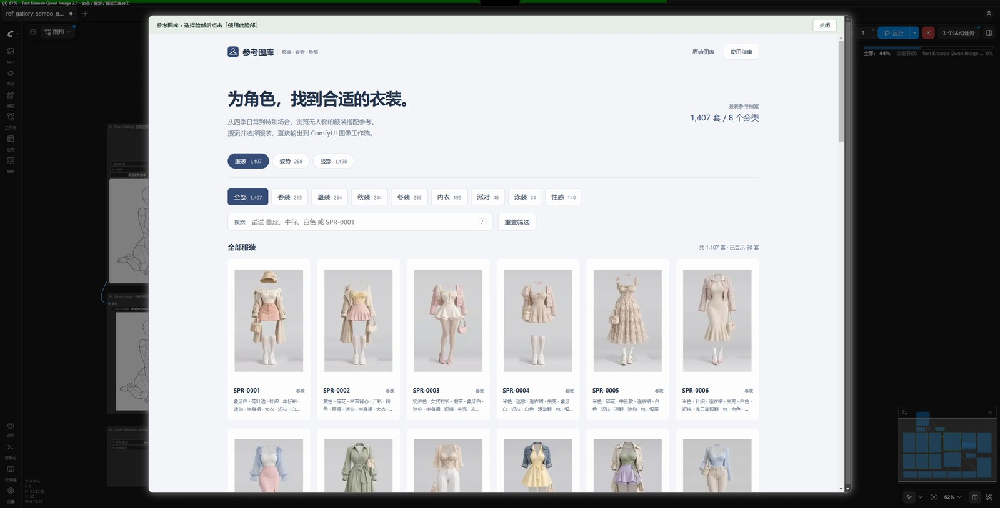
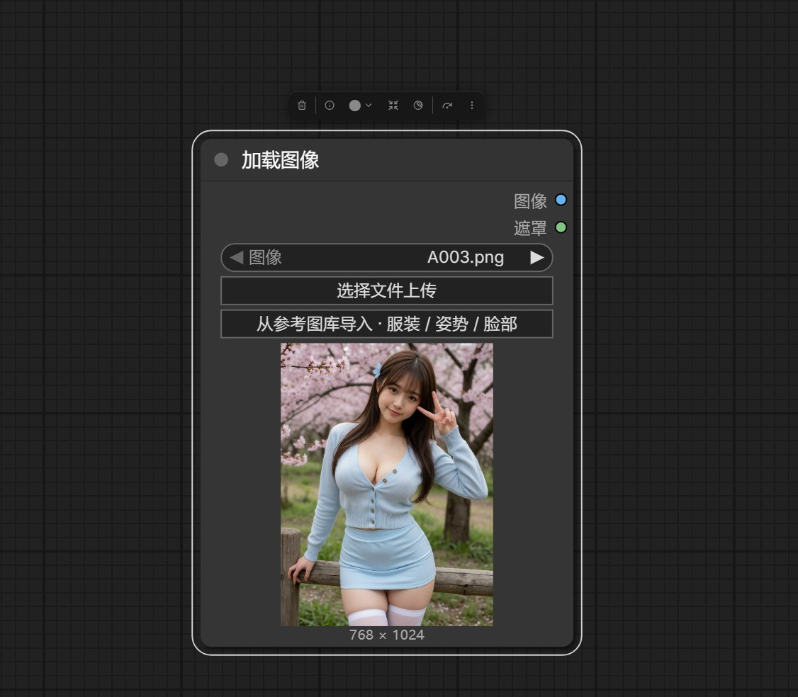
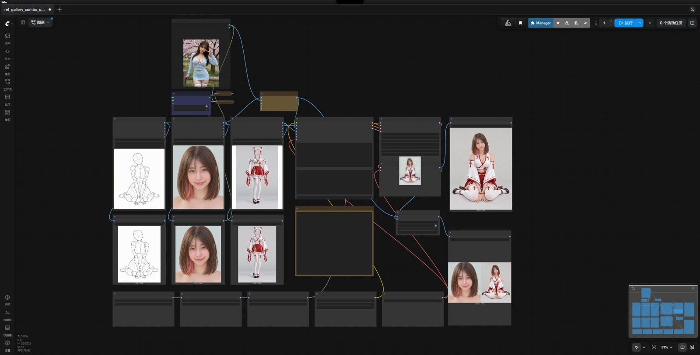
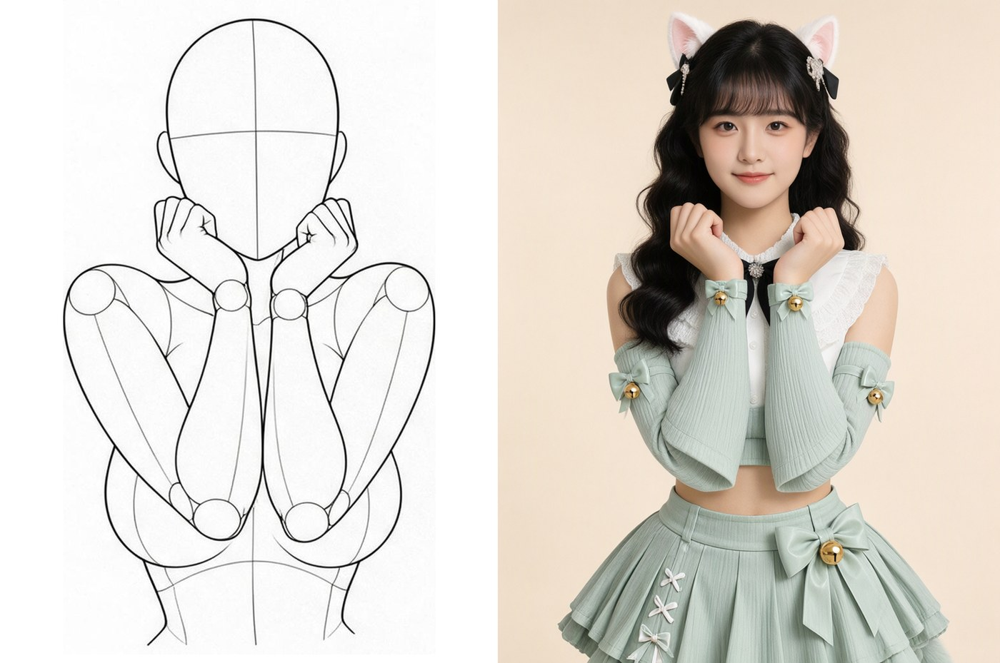

# comfyui-ref-lookbook · 参考图册

ComfyUI 节点包：把姿势、脸、服装三套公开的 AI 参考素材收进一个图库节点，组合出图。**仓库只发行代码、索引与缩略图，不含原图。**

A ComfyUI node pack that turns three public AI-reference libraries (pose / face / costume) into one gallery, so a single image can be composed from all three.

| 库 | 节点 | 记录 | 图片 | 分类 | 编号 |
| --- | --- | --- | --- | --- | --- |
| 服装 | `CostumeGallery` | 1,407 套 | 1,407 张 | 春装 / 夏装 / 秋装 / 冬装 / 内衣 / 派对 / 泳装 / 性感 | `SPR-0001`、`SIN-0007` … |
| 姿势 | `PoseGallery` | 288 个动作 | 1,439 张（每动作 5 机位） | 全身·性感系 / 全身·标准系 / 上半身 / 双人互动 | `POS-SEXY-P001` … |
| 脸部 | `FaceGallery` | 1,498 张 | 1,498 张 | 脸部特写 / 造型 × 短发 / 中发 / 中长发 / 长发 | `FACE-0001` … |

合计 3,193 条记录、4,344 张参考图。三者互不依赖：可固定脸换装、固定装换脸、只换衣服做对比。

## 安装

```bash
cd ComfyUI/custom_nodes
git clone https://github.com/YaJing0412/comfyui-ref-lookbook.git
```

重启 ComfyUI，浏览器 `Ctrl+Shift+R`。无额外依赖（用 ComfyUI 自带的 Pillow / aiohttp）。

## 用法

1. 添加节点：`image → Reference Gallery → 服装 / 姿势 / 脸部图库`。
2. 点「浏览…图库」开弹窗，顶部页签切换三个库；支持一二级分类、中英日关键词与编号搜索（空格分隔按「同时包含」筛选）。点节点上的预览图也能打开。
3. 点卡片看大图，点「使用此素材 → ComfyUI」把编号写回节点（姿势同时写 `angle`）。
4. 姿势可在图库和节点上切换视角：正面 / 俯视 / 仰视 / 侧面 / 斜 45°。
5. 任意原生「加载图像」节点（如 `Load Image`）也能调这个图库：选中后原图落到 `ComfyUI/input/ref_<编号>.png` 并自动填进该节点的图像控件，同一素材反复导入只覆盖同一个文件。
6. 直接开 `?lib=pose&id=POS-SEXY-P001` 可定位到某条素材。





## 示例工作流

下载 [ref_gallery_combo_qwen21.json](example_workflows/ref_gallery_combo_qwen21.json)（30 KB），拖进 ComfyUI 画布即可。三库直接组合——姿势给动作与构图、脸给身份与发型、服装给衣服，不需要真人照片。画布上方的 `Fast Muter` 可一键切到「自上传模式」，用自己的照片当脸，不用改连线。

[example_workflows/](example_workflows/) 目录里是工作流、使用指南与效果图；[使用指南](example_workflows/ref_gallery_combo_qwen21.md) 讲依赖、参数与脸部来源切换。



| 线稿人偶 + 脸 + 服装 → 成图 | 自上传照片当脸 → 成图 |
| --- | --- |
|  |  |

其余对比与成图见[使用指南](example_workflows/ref_gallery_combo_qwen21.md#效果)。

## 工作流依赖

自定义节点一个：[rgthree-comfy](https://github.com/rgthree/rgthree-comfy)（提供 `Fast Muter` 等模式切换节点），ComfyUI Manager 搜 `rgthree` 装完重启。

模型四个，自行准备，放好后重启 ComfyUI。

| 文件 | 放到 | 大小 |
| --- | --- | --- |
| `qwen_image_2.1_int8_convrot.safetensors` | `models/diffusion_models/` | 6.8 GB |
| `qwen3vl_8b_int8_convrot.safetensors` | `models/text_encoders/` | 8.7 GB |
| `qwen_image_2.1_vae_bf16.safetensors` | `models/vae/` | 644 MB |
| `VNCCS_QI2_PoseStudioV2.safetensors` | `models/loras/` 根目录 | 152 MB |

LoRA 是 AHEKOT 的 VNCCS PoseStudio Qwen Image 2.1 v2.0：[Civitai](https://civitai.com/models/2957080/vnccs-posestudio-qwen-image-21) 或 [HuggingFace](https://huggingface.co/MIUProject/VNCCS_PoseStudio_QI2.1)（HF 文件名尾部带空格，下载后去掉）。只用 `LoraLoaderModelOnly` 加载，不需要 `ComfyUI_VNCCS_Utils`。

## 节点输出

| 输出 | 类型 | 内容 |
| --- | --- | --- |
| `image` | IMAGE | PNG 原图，RGB，保持原始尺寸；透明区域合成白底 |
| `width` / `height` | INT | 原始尺寸 |
| `costume_id` / `pose_id` / `face_id` | STRING | 素材编号 |
| `description` | STRING | 分类 + 二级分类 + 中文关键词 |
| `keywords_en` / `description_ja` | STRING | 原始英文关键词 / 原始日文描述 |

姿势节点额外有 `angle` 下拉（默认「正面」）。标签可能不完整，只作检索提示。这三个节点只提供参考图，本身不换装、不换脸。

## 图片怎么来

**缩略图**（4,344 张 WebP，约 13 MB）随仓库内置，重打包自 [ai-ref-library-cn](https://github.com/sleepy-zone/ai-ref-library-cn) 的内嵌缩略图，内容未修改，离线可完整浏览。

**原图**不进仓库（体积大，且上游禁止再分发），运行时按素材文件名拼源站地址取一次：

| 库 | 原图地址 |
| --- | --- |
| 服装 | `ai-costume-gallery.pages.dev/png/<文件名>.png` |
| 姿势 | `ai-pose-gallery.pages.dev/img/<文件名>.png` |
| 脸部 | `ai-portrait-gallery.pages.dev/img/full/<文件名>.png` |

取图逻辑（`catalog.ensure_original`）：本机 `library/<库>/png/` 有就读，不联网 → 没有则取一次，先写 `.part` 再原子替换，校验文件头挡错误页和半截文件 → 失败时报错，信息里带完整地址和应放位置。

只有「浏览大图」和「节点出图」会取原图，共用 `library/<库>/png/` 缓存，任一处取过另一处直接命中。不做全库预取；并发受限（缩略图 8、原图 3），同一张串行，避免被上游当批量抓取。

想完全离线：按 `library/data/*-zh.json` 的「原图」字段把文件放进 `library/{costume,pose,face}/png/`，再设 `COMFYUI_REF_LOOKBOOK_OFFLINE=1`。

## 目录结构

```text
comfyui-ref-lookbook/
├── library/
│   ├── data/            # 三库中文索引、分类与元数据（约 1.7 MB）
│   ├── costume/{thumbs,png,img}/
│   ├── pose/{thumbs,png,img}/
│   ├── face/{thumbs,png,img}/
│   └── SOURCE.json      # 素材版本、数量与上游地址模板
├── web/                 # ComfyUI 扩展、三库统一弹窗界面
├── example_workflows/   # 示例工作流 + 说明 + 效果图
├── licenses/            # 上游参考项目的许可原文
└── tests/               # 37 个 Python 测试 + 6 个前端测试
```

`library/**/thumbs/` 随仓库内置；`png/`、`img/` 进 `.gitignore`，运行时生成。

## 环境变量

| 变量 | 默认 | 作用 |
| --- | --- | --- |
| `COMFYUI_REF_LOOKBOOK_LIBRARY` | 节点内 `library/` | 换图库根目录，需含 `data/` 与三个库子目录 |
| `COMFYUI_REF_LOOKBOOK_OFFLINE` | 未设 | `1` = 只用本地图片，缺图直接提示地址，永不联网 |
| `COMFYUI_REF_LOOKBOOK_TIMEOUT` | `60` | 单次下载超时（秒） |
| `COMFYUI_REF_LOOKBOOK_THUMB_WIDTH` | `360` | 缩略图缓存宽度 |
| `COMFYUI_REF_LOOKBOOK_THUMB_WORKERS` | `8` | 缩略图并发上限，别调太高 |

## 素材来源与许可

| 库 | 源站 | 作者 | 授权 | 可再分发 |
| --- | --- | --- | --- | --- |
| 服装 | [衣装集 COSTUME-DB-01](https://ai-costume-gallery.pages.dev/) | ギア [@giaaibusi](https://x.com/giaaibusi) | 可商用、可编辑、可参考；禁止再分发图片本体（含加工版），禁止批量抓取 | ❌ |
| 姿势 | [姿勢集 POSE-DB-01](https://ai-pose-gallery.pages.dev/) | ギア [@giaaibusi](https://x.com/giaaibusi) | 同上 | ❌ |
| 脸部 | [AIモデル顔データベース](https://ai-portrait-gallery.pages.dev/) | あぎ [@agi_aibusi](https://x.com/agi_aibusi) | CC0 | ✅（本仓库仍不分发） |

三套素材全是 AI 生成，不含真实人物。

参考项目：

| 项目 | 本仓库用它做了什么 |
| --- | --- |
| [wangweihong/ai-costume-gallery-zh](https://github.com/wangweihong/ai-costume-gallery-zh) | 界面结构与中文分类思路（MIT，见 [`licenses/`](licenses/)） |
| [wangweihong/comfyui-pose-gallery](https://github.com/wangweihong/comfyui-pose-gallery) | 节点与弹窗的交互方式（MIT，见 [`licenses/`](licenses/)） |
| [anhao/ai-pose-gallery-zh](https://github.com/anhao/ai-pose-gallery-zh) | 汉化与分类口径的参考 |
| `ai-ref-library-cn`（本地参考） | 姿势动作清单、脸部发型分类与中文标签；内置缩略图来源 |

本项目独立编写的部分：三库合成一个节点包并统一分类与搜索；节点预览直接画在画布上（不用 DOM 控件，避免布局漂移与溢出）；「本机 → 源站 → 缓存」取图链路、原子写入、文件头校验、离线模式；选中素材可导入任意原生节点。

参考关系不代表上述作者为本项目背书，也不代表他们授权你使用素材。

## 合规边界

- **原图与全尺寸预览不分发**（`library/**/{png,img}` 已进 `.gitignore`），运行时按单张取到你自己机器上；不做全库预取、不做批量导出。
- **缩略图随仓库内置属已知取舍**：上游「画像データそのもの（元サイズ・加工後を含む）の再配布は禁止」按字面涵盖缩略图，内置超出明示授权。权利人提出异议即移出，功能不受影响（见 [THIRD_PARTY_NOTICES.md](THIRD_PARTY_NOTICES.md)）。
- 二次分发、打包合集、在线服务请自行取得原作者授权，本仓库不是授权凭证。
- 清理本地缓存：删 `library/{costume,pose,face}` 下的 `png`/`img` 即可（保留 `.gitkeep`）。

## 验证

```bash
python -m unittest discover -s tests -v
node --test tests/test_preview.mjs
node --check web/ref_gallery.js && node --check web/gallery.mjs
```

37 个 Python 测试覆盖索引完整性、缩略图逐条在库、路径穿越与越库访问拒绝、按视角取图、上游地址模板、缓存命中、离线提示、节点预览 URL 与错误回退；6 个前端测试覆盖预览取图、视角联动与旧请求不覆盖新选择。

## 权利联系

权利人对收录内容有异议，请开 [Issue](https://github.com/YaJing0412/comfyui-ref-lookbook/issues) 并附素材 ID 与路径，核实后删除或调整。

代码以 [MIT](LICENSE) 发布；`library/data/` 的中文索引与译文、以及任何图片不在 MIT 范围内，边界见 [THIRD_PARTY_NOTICES.md](THIRD_PARTY_NOTICES.md)。
