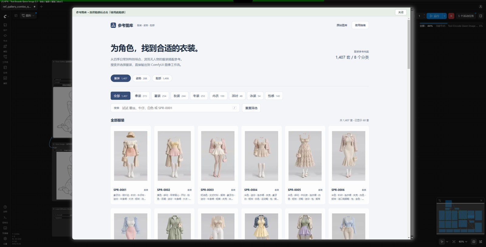
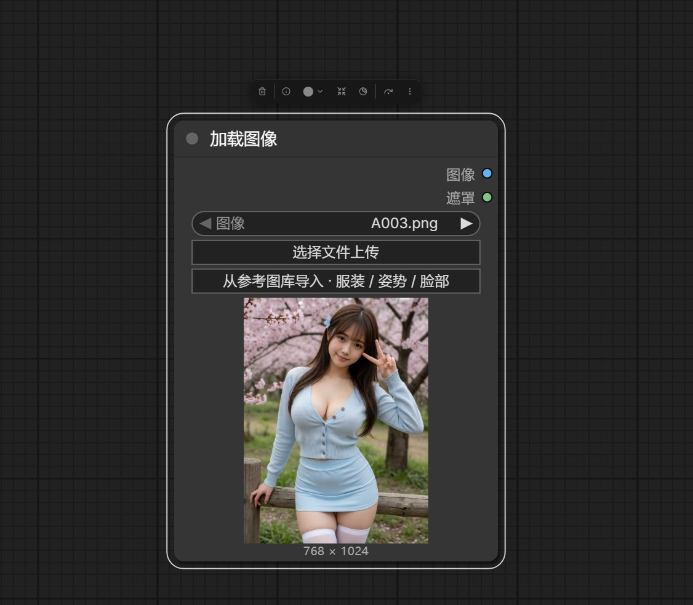
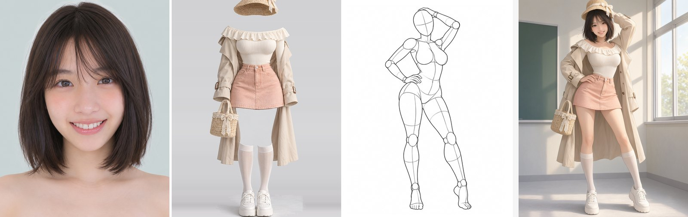

# comfyui-ref-lookbook · 参考图册

ComfyUI 节点包：把服装、服装动画、姿势、脸、深度姿势、二次元六套公开的 AI 参考素材收进一个图库节点，组合出图；另有一个独立的设计档案库（霧島澪，自带作者原版提示词）单开页面。**仓库发行代码、索引与内置缩略图，不含原图本体。**

A ComfyUI node pack that turns six public AI-reference libraries (costume / costume-anime / pose / face / depth / anime) into one gallery, so a single image can be composed from all six.

| 库 | 节点 | 记录 | 图片 | 分类 | 编号 |
| --- | --- | --- | --- | --- | --- |
| 服装 | `CostumeGallery` | 1,407 套 | 1,407 张 | 春装 / 夏装 / 秋装 / 冬装 / 内衣 / 派对 / 泳装 / 性感 | `SPR-0001`、`SIN-0007` … |
| 服装动画 | `CostumeAnimeGallery` | 1,320 套 | 1,320 张 | 与服装同一套 8 个分类，动漫画风 | `SPR-0001`、`SXY-0092` … |
| 姿势 | `PoseGallery` | 288 个动作 | 1,439 张（每动作 5 机位） | 全身·性感系 / 全身·标准系 / 上半身 / 双人互动 | `POS-SEXY-P001` … |
| 脸部 | `FaceGallery` | 1,498 张 | 1,498 张 | 脸部特写 / 造型 × 短发 / 中发 / 中长发 / 长发 | `FACE-0001` … |
| 深度姿势 | `DepthGallery` | 288 个动作 | 1,439 张（每动作 5 机位） | 与姿势库同一批动作，灰度深度图 | `DEP-SEXY-P001` … |
| 二次元 | `AnimeGallery` | 1,027 组 | 1,308 张（姿势另有线稿） | 发型与眼睛 / 服装 / 姿势 | `ANE-H001`、`ANE-O001`、`ANE-P001` … |
| 澪设计档案 | `MioGallery` | 387 件（43 卷） | 387 张（418 px，按格重切） | 发型 6 卷 / 服装 13 卷 / 姿势 24 卷 | `H-01-01`、`C-06-02`、`P-20-07` … |

合计 5,828 条记录、8,411 张参考图。六个库互不依赖：可固定脸换装、固定装换脸、只换衣服做对比。深度姿势库与姿势库是同一批 288 个动作、同样文件名，只是内容换成灰度深度图，可直接接 ControlNet depth。二次元库把发型与眼睛、服装、姿势三组混在一个库里（编号前缀 `H` / `O` / `P` 区分），姿势另有线稿版本，适合二次元出图。服装动画库与服装库是同一批分类、同一套编号规则的两版不同画风，各自独立编号、互不补齐，**同一编号在两个库里是两张不同的图**，别指望用编号互相找回。

另有一个「澪设计档案」库（`MioGallery`，387 件）**不属于这六个**，也**不占六库页签**：它是按作者系列分卷的设计档案（每卷 9 件），每件带作者写好的中英文提示词，浏览页面独立在 `/ref_lookbook/mio`。源站单件与合集都只发布一档（没有大图目录），本库的图按每卷合集重切（见下方「画质上限」），所以这个库的定位是「参考 + 提示词」，不是高分辨率出图素材——想要大图就靠它给的 prompt 重绘。

另有三个节点不属于六库：`CharacterRecipe`（四合一角色配方）把发型、脸部、服装、姿势合成一次取图，输出四张图 + 一张参考整图 + 中英文合成提示词；`HairGallery`（发型图库）把澪设计与二次元两个来源里的发型抽成一个节点，靠一个下拉切换；`MioGallery`（澪设计档案）单取一件，输出图 + 作者原版中英文提示词。

当前版本 **v1.7.1**。每个版本新增了什么、修了什么，见[更新日志](更新日志.md)。

## 安装

```bash
cd ComfyUI/custom_nodes
git clone https://github.com/YaJing0412/comfyui-ref-lookbook.git
```

重启 ComfyUI，浏览器 `Ctrl+Shift+R`。无额外依赖（用 ComfyUI 自带的 Pillow / aiohttp）。

## 不开 ComfyUI 单独用（HTTP 模式）

插件根目录自带一个零依赖的独立服务（只用 Python 标准库），浏览体验与 ComfyUI 内完全一致：

```bash
python server.py            # 打开 http://127.0.0.1:8180/ref_lookbook/gallery
```

Windows 下直接双击 `start_gallery.bat` 也行（没装 Python 时会提示）。

| 参数 | 默认 | 说明 |
| --- | --- | --- |
| `--port` | `8180` | 监听端口 |
| `--host` | `127.0.0.1` | 监听地址；改 `0.0.0.0` 会对局域网开放，启动时打印安全提醒 |
| `--library` | 插件内 `library/` | 换图库根目录（需含 `data/` 与六个库子目录） |
| `--export-dir` | 插件内 `exports/` | 「导入」落盘目录（独立模式没有 ComfyUI 的 `input/`，改存这里） |

与 ComfyUI 模式共用同一份 `library/`：独立模式下看过的大图、节点里出过图的原图，都落在同一个 `library/<库>/png/`，两种启动方式互相通用。`GET /ref_lookbook/status` 可自检各库计数与缓存情况。

## 澪设计档案（独立页面）

`MioGallery` 对应 [霧島澪的设计档案](https://sleepyzone.online/mio-design-archive/)：43 卷 387 件，每件附作者写好的英文提示词与中文对照。

数据是「系列 → 卷 → 9 件」，所以它**不进六库页签**、走自己的页面；但**版式与六库页完全一致**——同一份 `style.css`、同一个骨架（顶栏 → 大标题 → 一级菜单 → 二级页签 → 三级分类 → 搜索 → 结果行 → 网格 → 详情弹窗），只是把二级换成「系列」、三级换成「卷」：

- 一级菜单：日系图库 / 澪图库，两个页面顶部各一份，互相跳转
- 二级页签：全部 / 发型 54 / 服装 117 / 姿势 216
- 三级卷条：选中系列后才出现（全部状态下 43 卷会铺满整屏），点一下切到该卷，正好九宫格 3×3；桌面固定 3 列，手机 2 列
- 搜索在当前视图内筛（在卷里搜就是搜这一卷），`重置筛选` 回全部
- 独立启动时开 `http://127.0.0.1:8180/ref_lookbook/mio`；`#all` 全部、`#s-hair` 某系列、`#hair-01` 某一卷
- ComfyUI 里点节点按钮，弹窗内直接选图（与六库同一套 iframe 协议，选完回填 `mio_id`）
- 点作品看大图与两个提示词，各带「复制」；← → 切换上一件 / 下一件，Esc 关闭

**新图库照这个抄**：以后再有按系列 / 按卷组织的库，复制 `web/mio.html` 改数据接口和栏目名即可，**不要新建第二个 CSS**——界面统一靠的就是全站只有一份样式表。

**画质上限**：源站最大边长就 418 px（`assets/full`、`assets/orig`、`assets/items` 全 404）。**不用源站的单件图**——那是按固定步长从合集切的，切点与真实格边界差 4~40 px，相邻格的标题会被切进本格底部、本格标题顶部被削掉，卡片上就多出半行黑字。本库的每张图都从每卷合集按「切完每格上下都是留白」重切，格式仍是 JPEG。所以这个库适合当「参考构图 + 提示词模板」，不适合直接放大输出——要高清就把它的 prompt 丢进文生图重绘。

## 用法

1. 添加节点：`image → Reference Gallery → 服装 / 服装动画 / 姿势 / 脸部 / 深度姿势 / 二次元 / 发型`，以及四合一角色配方。
2. 点「浏览…图库」开弹窗。菜单三层：最上面一级选「日系图库 / 澪图库」，日系图库下二级页签切换六个库，三级分类按钮再按分类筛；支持中英日关键词与编号搜索（空格分隔按「同时包含」筛选）。点节点上的预览图也能打开。
3. 点卡片看大图，点「使用此素材 → ComfyUI」把编号写回节点（姿势同时写 `angle`，二次元同时写 `variant`）。
4. 姿势与深度姿势可在图库和节点上切换视角：正面 / 俯视 / 仰视 / 侧面 / 斜 45°；二次元库可切换彩图 / 线稿（线稿只覆盖姿势组）。
5. 任意原生「加载图像」节点（如 `Load Image`）也能调这个图库：选中后原图落到 `ComfyUI/input/ref_<编号>.png` 并自动填进该节点的图像控件，同一素材反复导入只覆盖同一个文件。服装动画库因为与服装库共用编号，文件名带库前缀（`ref_anime-SPR-0001.png`），两库同编号素材能同时存在于 `input/`。
6. 直接开 `?lib=pose&id=POS-SEXY-P001` 可定位到某条素材；再带 `&angle=斜45°`（二次元用 `&angle=线稿`）能直接切到该形态。
7. 深度姿势库可以直接接 ControlNet：`DepthGallery` 的 `image` 输出就是灰度深度图，连到 `ControlNetApplyAdvanced` 的 `image` 即可，不需要再加预处理器（图已经是深度图，再过一遍 depth 预处理器等于重复处理）。姿势库与深度姿势库编号一一对应，`POS-SEXY-P031` 对应 `DEP-SEXY-P031`，想要「线稿控姿态」用姿势库、想要「深度控体积」用深度姿势库。
8. 澪设计档案（`MioGallery`）走自己的页面，但版式与六库页一致：一级菜单点「澪图库」，二级页签选系列（全部 / 发型 / 服装 / 姿势），三级卷条选卷，点作品看大图与中英文提示词，两个「复制」按钮直接拿走去用。独立启动时也可以直接开 `http://127.0.0.1:8180/ref_lookbook/mio`，`#all` / `#s-hair` / `#hair-01` 可定位。
9. 四合一配方节点 `CharacterRecipe`：发型、脸、服装、姿势四行各自有按钮和缩略图，点哪个换哪个；`style_preset` 选风格方向盘（日系动漫 / 写实摄影 / 韩系半厚涂 / 角色设定图），`extra_prompt` 补细节。发型槽自带来源下拉（澪设计 / 二次元），在弹窗里切到另一边选了一件，来源开关会跟着拨过去。打开 `use_depth` 时姿势槽位自动改读深度库（`POS-` → `DEP-`），预览也跟着变，直接接 ControlNet depth。输出里 `reference_sheet` 是四张并排的参考整图，适合丢给 img2img 或作为视觉参考。
10. 发型图库（`HairGallery`）是独立节点：`hair_source` 切换「澪设计」（6 卷 54 件，带作者原版中英文提示词）与「二次元」（230 条动漫头型，只有关键词）。切来源后编号若不是该来源的形态会自动回落，不用手动改。输出多了 `prompt` / `prompt_zh` 两路，可以直接接 CLIP Text Encode。





## 示例工作流

**只有一个文件**：[ref_gallery_qwen21.json](example_workflows/ref_gallery_qwen21.json)（31 KB），拖进画布即可。以前分成「三库组合」和「三合一配方」两份，现在合成一份——同一套模型加载与采样，并排放两条出图链，想用哪条跑哪条。

| 分组 | 取素材方式 | 适合 |
| --- | --- | --- |
| ① 单独节点（画布上方） | 发型 / 脸部 / 服装 / 姿势 四个图库节点各点一次 | 想逐张换、逐张对比 |
| ② 四合一配方（画布下方） | `CharacterRecipe` 一个节点四行点完，提示词自动拼好 | 常规出图 |

参考图顺序两边一致，固定不能交换：`image_1` 姿势定动作与构图、`image_2` 脸定身份、`image_3` 服装定穿着、`image_4` 发型定头顶造型。配方那条链把这四路输出原样接进编码器，`prompt_zh` 也自动连过去，只剩点按钮。

两条链各自成组，直接点运行会两条一起跑、白等一半时间。所以画布最上方有个**「示例开关」**：点「① 单独节点取图」就只跑 ①、② 整组静音，点「② 四合一配方」反过来。开关是单选——再点当前那组不会两组全关，状态随工作流一起存盘，默认只跑 ①。它是本插件自带的前端节点，不进执行队列，也不占额外依赖。

> 开关是纯前端节点，**升级插件后要先刷新一次浏览器页面（F5）**，Web 前端才会加载到新的节点类型。没刷新就打开工作流，右侧会提示「缺少节点包 `ref_lookbook/WorkflowSwitch`」，画布上只剩一个空的紫框、没有按钮——刷新后重新打开工作流即可恢复。判断是否已加载：控制台执行 `LiteGraph.registered_node_types["ref_lookbook/WorkflowSwitch"]`，有值就是加载好了。

不需要任何额外插件——上一版「三库组合」用的 `Fast Muter`（rgthree-comfy）没并进来，所以这份 json 只用 ComfyUI 内置节点加本插件自带的一个开关。想用自己的照片当脸，画布右上有一张空的 `Load Image`，把 `image_2` 那根线拖过去即可，其余不动。

[使用指南](example_workflows/ref_gallery_qwen21.md) 讲四张参考的分工、发型库两个来源、提示词三条切法、深度模式与切库参数，以及深度图为什么不能直接当 Qwen 的参考。

| 线稿人偶 + 脸 + 服装 + 发型 → 成图 | 四张参考 → 成图（四合一配方） |
| --- | --- |
|  |  |

其余对比与成图见[使用指南](example_workflows/ref_gallery_qwen21.md#效果)。

## 工作流依赖

| 工作流 | 额外插件 |
| --- | --- |
| `ref_gallery_qwen21`（四库出图，两种用法一份文件） | 无，只用 ComfyUI 内置节点 |

模型四个，自行准备，放好后重启 ComfyUI。

| 文件 | 放到 | 大小 |
| --- | --- | --- |
| `qwen_image_2.1_int8_convrot.safetensors` | `models/diffusion_models/` | 6.8 GB |
| `qwen3vl_8b_int8_convrot.safetensors` | `models/text_encoders/` | 8.7 GB |
| `qwen_image_2.1_vae_bf16.safetensors` | `models/vae/` | 644 MB |
| `VNCCS_QI2_PoseStudioV2.safetensors` | `models/loras/` 根目录 | 152 MB |

LoRA 是 AHEKOT 的 VNCCS PoseStudio Qwen Image 2.1 v2.0：[Civitai](https://civitai.com/models/2957080/vnccs-posestudio-qwen-image-21) 或 [HuggingFace](https://huggingface.co/MIUProject/VNCCS_PoseStudio_QI2.1)（HF 文件名尾部带空格，下载后去掉）。只用 `LoraLoaderModelOnly` 加载，不需要 `ComfyUI_VNCCS_Utils`。

## 节点输出

| 输出 | 类型 | 内容 |
| --- | --- | --- |
| `image` | IMAGE | PNG 原图，RGB，保持原始尺寸；透明区域合成白底 |
| `width` / `height` | INT | 实际输出尺寸 |
| `costume_id` / `pose_id` / `face_id` | STRING | 素材编号 |
| `description` | STRING | 分类 + 二级分类 + 中文关键词 |
| `keywords_en` / `description_ja` | STRING | 原始英文关键词 / 原始日文描述 |

六个图库节点都有四个可选参数，默认值等于以前的行为，老工作流不受影响：

| 参数 | 默认 | 说明 |
| --- | --- | --- |
| `resize_mode` | 原图尺寸 | 换成「指定尺寸（居中裁剪）」「指定尺寸（留白填充）」后按下面宽高输出 |
| `width` / `height` | 1024 / 1280 | 仅指定尺寸模式生效，8 的倍数，64–8192 |
| `flip_horizontal` | 否 | 水平翻转，人物朝左 / 朝右互换 |

`MioGallery` 的输出（多了作者原版提示词）：

| 输出 | 类型 | 内容 |
| --- | --- | --- |
| `image` | IMAGE | 单件图，长边 418 px（按卷合集重切） |
| `width` / `height` | INT | 实际输出尺寸 |
| `mio_id` | STRING | 编号，如 `C-06-02` |
| `description` | STRING | 系列 / 卷主题 / 关键词 |
| `prompt` | STRING | 作者原版英文提示词，可直接进 CLIP Text Encode |
| `prompt_zh` | STRING | 作者原版中文提示词（逐条对照，不是机器翻译） |

`HairGallery` 的输出（多了两路提示词）：

| 输出 | 类型 | 内容 |
| --- | --- | --- |
| `image` | IMAGE | 发型参考图 |
| `width` / `height` | INT | 实际输出尺寸 |
| `hair_id` | STRING | 编号，如 `H-01-01`（澪设计）/ `ANE-H001`（二次元） |
| `description` | STRING | 系列 / 卷 / 分类关键词 |
| `prompt` | STRING | 英文提示词：澪设计取作者原版整句，二次元取英文关键词 |
| `prompt_zh` | STRING | 中文提示词：澪设计取作者原版，二次元取中文关键词 |

`CharacterRecipe` 的输出：

| 输出 | 类型 | 内容 |
| --- | --- | --- |
| `face_image` / `costume_image` / `pose_image` / `hair_image` | IMAGE | 四张参考图，已统一尺寸 |
| `reference_sheet` | IMAGE | 四张横向拼图（间隔 12 px，白底），定头顶造型 + 定人 + 定装 + 定动作一张看全 |
| `width` / `height` | INT | 拼图尺寸 |
| `prompt_zh` | STRING | 中文合成提示词：风格 + 发型 + 人像 + 服装 + 动作构图 + 澪设计发型原句 + 补充细节 |
| `prompt_en` | STRING | 英文合成提示词：风格 + 服装英文关键词 + 发型英文关键词 + 「参考图定脸和姿势」。脸部与姿势索引没有英文词条，不硬翻日文 |

`hair_image` 排在输出末尾而不是插进前面：旧工作流的连线按序号存，插到中间会让 `face` / `costume` / `pose` 全部错位一格，老图一打开就串图。

配方节点的 `costume_library` 可切写实服装 / 服装动画（编号规则一致），`use_depth` 打开时姿势取同编号深度图，`hair_source` 切发型来源。`pose_angle` 是姿势的五个机位。

姿势与深度姿势节点额外有 `angle` 下拉（默认「正面」），二次元节点有 `variant` 下拉（默认「彩图」）。标签可能不完整，只作检索提示。这九个节点只提供参考图，本身不换装、不换脸。

## 图片怎么来

**缩略图**（8,411 张 WebP，约 60 MB）随仓库内置：前三个库原样取自 [ai-ref-library-cn](https://github.com/sleepy-zone/ai-ref-library-cn) 的内嵌缩略图（200×250，未改动），深度库与二次元库取自各自源站缩略图并统一转成 360 px WebP，服装动画库源站缩略图本身就是 360×540，原样落盘不再转码。离线可完整浏览。

**原图**不进仓库（体积大，且上游禁止再分发），运行时按素材文件名拼源站地址取一次：

| 库 | 原图地址 |
| --- | --- |
| 服装 | `ai-costume-gallery.pages.dev/png/<文件名>.png` |
| 服装动画 | `ai-costume-anime-gallery.pages.dev/png/<文件名>.png` |
| 姿势 | `ai-pose-gallery.pages.dev/img/<文件名>.png` |
| 脸部 | `ai-portrait-gallery.pages.dev/img/full/<文件名>.png` |
| 深度姿势 | `ai-pose-depth-gallery.pages.dev/img/<文件名>.png` |
| 二次元 | `charadb-2fi.pages.dev/img/<文件名>.jpg`（线稿为 `line/<文件名>.png`） |

**澪设计档案例外**：源站没有更高清版本，所以这 387 张原始 JPEG（约 9 MB）直接随仓库内置在 `library/mio/thumbs/`，节点的「原图」字段指向的就是同一个文件——不重复存两份，也不缩到 360 转 WebP（那会让唯一的那档画质更差）。仓库对它是**原图与缩略图一起分发**，与六库只发缩略图不同，理由就是没有第二档可发。

取图逻辑（`catalog.ensure_original`）：本机 `library/<库>/png/` 有就读，不联网 → 没有则取一次，先写 `.part` 再原子替换，校验文件头挡错误页和半截文件 → 失败时报错，信息里带完整地址和应放位置。

默认只按单张取图：只有「浏览大图」和「节点出图」会取原图，共用 `library/<库>/png/` 缓存，任一处取过另一处直接命中。并发受限（缩略图 8、原图 12），同一张串行——12 是实测的吞吐拐点，再高没有收益，也不会把源站拖垮。

想完全离线：按 `library/data/*-zh.json` 的「原图」字段自己放文件到 `library/{costume,costume-anime,pose,face,depth,anime}/png/`，再设 `COMFYUI_REF_LOOKBOOK_OFFLINE=1`。

## 目录结构

```text
comfyui-ref-lookbook/
├── 更新日志.md          # 每版新增与修复
├── library/
│   ├── data/            # 六库 + mio 中文索引、分类与元数据（约 3.9 MB）
│   ├── costume/{thumbs,png,img}/
│   ├── costume-anime/{thumbs,png,img}/
│   ├── pose/{thumbs,png,img}/
│   ├── face/{thumbs,png,img}/
│   ├── depth/{thumbs,png,img}/
│   ├── anime/{thumbs,png,img}/
│   ├── mio/{thumbs,png}/  # 平铺库：原图=缩略图同一份，png/ 只留占位
│   └── SOURCE.json      # 素材版本、数量与上游地址模板
├── web/                 # ComfyUI 扩展 + 一套样式表（style.css）撑起六库页与澪图库页
├── server.py            # 独立 HTTP 服务（不开 ComfyUI 也能浏览）
├── start_gallery.bat    # Windows 双击启动
├── example_workflows/   # 示例工作流 + 说明 + 效果图
├── licenses/            # 上游参考项目的许可原文
└── tests/               # 126 个 Python 测试 + 17 个前端测试
```

`<库>/thumbs/` 随仓库内置（8,411 张 WebP，离线开箱可浏览）；`<库>/png/`、`<库>/img/` 进 `.gitignore`，只留 `.gitkeep` 占位。原图一律运行时获取：你在弹窗里看过、或在节点上出过图的那张，就落进对应目录，之后不再下载。

## 环境变量

| 变量 | 默认 | 作用 |
| --- | --- | --- |
| `COMFYUI_REF_LOOKBOOK_LIBRARY` | 节点内 `library/` | 换图库根目录，需含 `data/` 与六个库子目录 |
| `COMFYUI_REF_LOOKBOOK_OFFLINE` | 未设 | `1` = 只用本地图片，缺图直接提示地址，永不联网 |
| `COMFYUI_REF_LOOKBOOK_TIMEOUT` | `60` | 单次下载超时（秒） |
| `COMFYUI_REF_LOOKBOOK_THUMB_WIDTH` | `360` | 缩略图缓存宽度 |
| `COMFYUI_REF_LOOKBOOK_THUMB_WORKERS` | `8` | 缩略图并发上限，别调太高 |
| `COMFYUI_REF_LOOKBOOK_ORIGIN_SLOTS` | `12` | 原图并发上限（1–32）。12 是实测吞吐拐点，单张约 1.5 秒，再高没有收益 |

## 素材来源与许可

| 库 | 源站 | 作者 | 授权 | 可再分发 |
| --- | --- | --- | --- | --- |
| 服装 | [衣装集 COSTUME-DB-01](https://ai-costume-gallery.pages.dev/) | ギア [@giaaibusi](https://x.com/giaaibusi) | 可商用、可编辑、可参考；禁止再分发图片本体（含加工版），禁止批量抓取 | ❌ |
| 姿势 | [姿勢集 POSE-DB-01](https://ai-pose-gallery.pages.dev/) | ギア [@giaaibusi](https://x.com/giaaibusi) | 同上 | ❌ |
| 脸部 | [AIモデル顔データベース](https://ai-portrait-gallery.pages.dev/) | あぎ [@agi_aibusi](https://x.com/agi_aibusi) | CC0 | ✅（本仓库仍不分发） |
| 深度姿势 | [デプスポーズ集 POSE-DB-02](https://ai-pose-depth-gallery.pages.dev/) | ギア [@giaaibusi](https://x.com/giaaibusi) | 与姿势集同条款：可参考使用，禁止再分发图片本体（含加工版） | ❌ |
| 二次元 | [キャラ組み立てDB CharaDB](https://charadb-2fi.pages.dev/) | たき AI [@taki_auto](https://x.com/taki_auto) | 参考使用；禁止再分发、转载、转售图片本体 | ❌ |
| 澪设计档案 | [Mio's Design Archive](https://sleepyzone.online/mio-design-archive/) | 霧島澪 [@Mio_2am](https://x.com/Mio_2am) | 站内未标注开放授权，按「个人参考使用」对待；本仓库只内置按卷合集重切出的单件图与提示词，不内置合集原图 | ❌ |
| 服装动画 | [衣装集 アニメ版 COSTUME-ANIME-DB](https://ai-costume-anime-gallery.pages.dev/) | ギア [@giaaibusi](https://x.com/giaaibusi) | 可商用、可编辑、可参考；禁止再分发、转载、转售图片本体，禁止批量获取，不得用于表现真实人物或未成年人 | ❌ |

六套素材全是 AI 生成，不含真实人物。姿势与脸部的中文标签、动作清单与内置缩略图取自 [sleepy-zone/ai-ref-library-cn](https://github.com/sleepy-zone/ai-ref-library-cn)——一个同样整理这三套素材的中文检索界面，只收录缩略图、不含原图；服装库的中文索引取自 [ai-costume-gallery-zh](https://github.com/wangweihong/ai-costume-gallery-zh)；深度姿势库的索引由姿势库派生、按深度站校对，缩略图取自深度站；二次元库与服装动画库的中文索引与分类取自同一中文项目的 anime 索引与 costume-anime 索引（[Deeyu/ai-costume-gallery-zh](https://github.com/Deeyu/ai-costume-gallery-zh)），缩略图分别取自 CharaDB 与动画服装站。

参考项目：

| 项目 | 本仓库用它做了什么 |
| --- | --- |
| [wangweihong/ai-costume-gallery-zh](https://github.com/wangweihong/ai-costume-gallery-zh) | 界面结构与中文分类思路（MIT，见 [`licenses/`](licenses/)） |
| [wangweihong/comfyui-pose-gallery](https://github.com/wangweihong/comfyui-pose-gallery) | 节点与弹窗的交互方式（MIT，见 [`licenses/`](licenses/)） |
| [anhao/ai-pose-gallery-zh](https://github.com/anhao/ai-pose-gallery-zh) | 汉化与分类口径的参考；「三合一合成配方」的思路（三库同取、横向参考拼图、按风格预设组装中英文提示词）。节点代码为独立实现（MIT，见 [`licenses/`](licenses/)） |

本项目独立编写的部分：六库合成一个节点包并统一分类与搜索；节点预览直接画在画布上（不用 DOM 控件，避免布局漂移与溢出）；「本机 → 源站 → 缓存」取图链路、原子写入、文件头校验、离线模式；选中素材可导入任意原生节点。

参考关系不代表上述作者为本项目背书，也不代表他们授权你使用素材。

## 合规边界

- **原图与全尺寸预览不分发**（`library/**/{png,img}` 已进 `.gitignore`），运行时按单张取到你自己机器上，没有任何后台自动预取。
- **缩略图随仓库内置属已知取舍**：上游「画像データそのもの（元サイズ・加工後を含む）の再配布は禁止」按字面涵盖缩略图，内置超出明示授权。权利人提出异议即移出，功能不受影响（见 [THIRD_PARTY_NOTICES.md](THIRD_PARTY_NOTICES.md)）。
- 澪设计档案的 387 张图是该站**唯一的一档**（没有更高清原图可另发），所以随仓库内置；合集图（`assets/sheets/*.jpg`）不分发。作者未在站内标注开放授权，按个人参考对待，权利人提出异议即移出。
- 二次分发、打包合集、在线服务请自行取得原作者授权，本仓库不是授权凭证。
- 清理本地缓存：删 `library/{costume,costume-anime,pose,face,depth,anime}` 下的 `png`/`img` 即可（保留 `.gitkeep`）。`library/mio/thumbs/` 是内置素材本身，删了要重新 `git checkout`。

## 验证

```bash
python -m unittest discover -s tests -v
node --test tests/test_preview.mjs
node --check web/ref_gallery.js && node --check web/gallery.mjs
```

112 个 Python 测试覆盖索引完整性、深度图与姿势图逐条对齐、二次元线稿与彩图配对、服装动画与服装编号重合但路径互不干扰、缩略图逐条在库、路径穿越与越库访问拒绝、按视角 / 形态取图、上游地址模板（含线稿的 `line/` 路径）、缓存命中、离线提示、节点预览 URL 与错误回退、按需缓存的 remote 参数，澪设计档案的平铺结构（原图与缩略图同文件、JPEG 从合集重切、每张长边 418 px、43 卷覆盖全量、每条都带中英提示词）、它与六库编号零交集、独立页面路由与「不进整库下载」、两个页面的一级菜单只有两项且当前页标记正确、澪页与六库页共用同一份样式表和同一个骨架（旧的 mio.css 必须 404）；外加独立 HTTP 服务的路由、白名单与穿越防护；17 个前端测试覆盖预览取图、视角联动、缩略图占位、旧请求不覆盖新选择，发型节点按来源切库与编号回落，四合一配方节点的四槽位取图、深度开关联动与画布绘制，以及「示例开关」的整组静音、单选不归零与坏状态回退。另有 14 个测试专门盯示例工作流：只允许存在一份 json、连线两端都成立、`widgets_values` 个数与 `INPUT_TYPES` 对得上（加槽位最容易在这儿错位）、配方四条参考的顺序与来源、单独节点那条链的 `image_4` 必须来自发型库，以及开关节点与三个分组标题对得上、① 组默认在跑而 ② 组默认静音、共用模型组永不被切、说明节点不落在任何组里。

## 权利联系

权利人对收录内容有异议，请开 [Issue](https://github.com/YaJing0412/comfyui-ref-lookbook/issues) 并附素材 ID 与路径，核实后删除或调整。

代码以 [MIT](LICENSE) 发布；`library/data/` 的中文索引与译文、以及任何图片不在 MIT 范围内，边界见 [THIRD_PARTY_NOTICES.md](THIRD_PARTY_NOTICES.md)。
