# 三库组合出图 · Qwen Image 2.1

姿势给动作、脸给身份、服装给穿搭，三张参考图直接合成一张人像，不需要真人照片。

## 依赖

| 类型 | 需要 | 说明 |
| --- | --- | --- |
| 自定义节点 | [rgthree-comfy](https://github.com/rgthree/rgthree-comfy) | 提供 `Fast Muter`、`Mute / Bypass Repeater`、`Any Switch` 三个节点，管脸部来源切换 |
| 内置节点 | `ImageStitch` | ComfyUI 自带，无需安装 |
| 模型 | 4 个文件，见下 | 放好后重启 ComfyUI |

| 文件 | 放到 | 大小 |
| --- | --- | --- |
| `qwen_image_2.1_int8_convrot.safetensors` | `models/diffusion_models/` | 6.8 GB |
| `qwen3vl_8b_int8_convrot.safetensors`（类型选 `qwen_image`） | `models/text_encoders/` | 8.7 GB |
| `qwen_image_2.1_vae_bf16.safetensors` | `models/vae/` | 644 MB |
| `VNCCS_QI2_PoseStudioV2.safetensors` | `models/loras/` **根目录** | 152 MB |

LoRA 是 AHEKOT 的 VNCCS PoseStudio Qwen Image 2.1 v2.0：[Civitai](https://civitai.com/models/2957080/vnccs-posestudio-qwen-image-21) 或 [HuggingFace](https://huggingface.co/MIUProject/VNCCS_PoseStudio_QI2.1)（HF 文件名尾带空格，下载后去掉）。必须放 `loras/` 根目录，不能建子目录——Windows 下子目录路径是反斜杠，工作流里写的是正斜杠，会匹配不到。

## 用法

1. 下载 [ref_gallery_combo_qwen21.json](ref_gallery_combo_qwen21.json)（30 KB），拖进 ComfyUI 画布导入。
2. 三个图库节点各点「浏览…图库」选素材。
3. 点运行。

三路参考顺序固定，不能交换：

| 端口 | 来源 | 给什么 |
| --- | --- | --- |
| `image_1` | `Pose Gallery` | 动作、四肢位置、身体朝向、机位与构图 |
| `image_2` | `Face Gallery` / 自上传 | 身份、脸型、五官、发型与发色 |
| `image_3` | `Costume Gallery` | 服装、配饰、颜色、材质与层次 |

参数：25 步、CFG 1、euler/simple、种子固定 `20261029`、1024 长边、LoRA 强度 1。

画布总览（点开看大图）：左侧三路图库 + 顶部自上传照片，中间拼提示词与采样，右侧出成图和对比图；整排变暗的是当前不生效的备用路径，由 `Fast Muter` 切换。

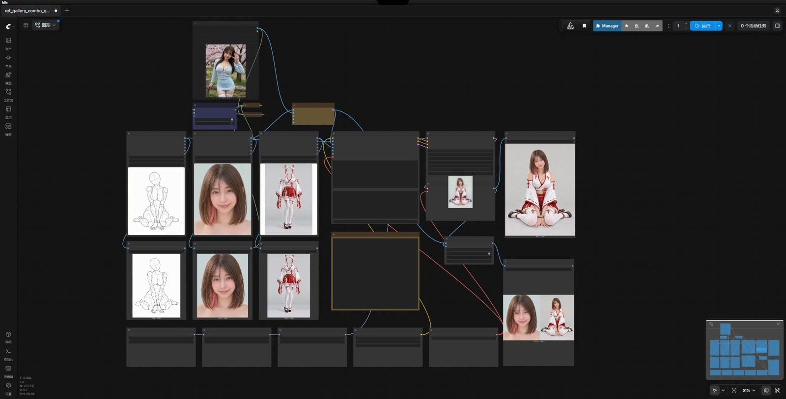

## 脸部来源切换

画布上方的 `Fast Muter` 控制两路，同一时间只有一路生效：

| 模式 | 脸来自 | 怎么切 |
| --- | --- | --- |
| 图库模式（默认） | `Face Gallery` | 点 `Fast Muter` 上的「Enable 图库模式」 |
| 自上传模式 | 上方 `Load Image` | 点「Enable 自上传模式」，在 `Load Image` 里放自己的照片 |

未启用的一路整体变暗、不执行，切换不用改连线。`Load Image` 底部有「从参考图库导入」按钮，选中素材后原图会复制成 `ComfyUI/input/ref_<编号>.png` 并自动填入，也可以直接上传本地照片。

## 效果

每组左侧是送进工作流的参考，右侧是成图。

### 姿势库 → 动作

| 深蓝蕾丝 · 举臂 |
| --- |
| 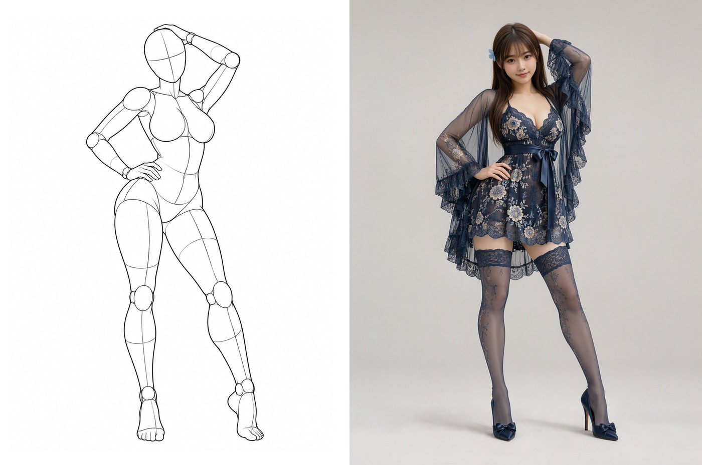 |
| 一手举过头顶、躯干微侧，线稿只定动作与机位，发饰与裙型由另外两路补 |

| 深蓝蕾丝 · 叉腰 |
| --- |
| 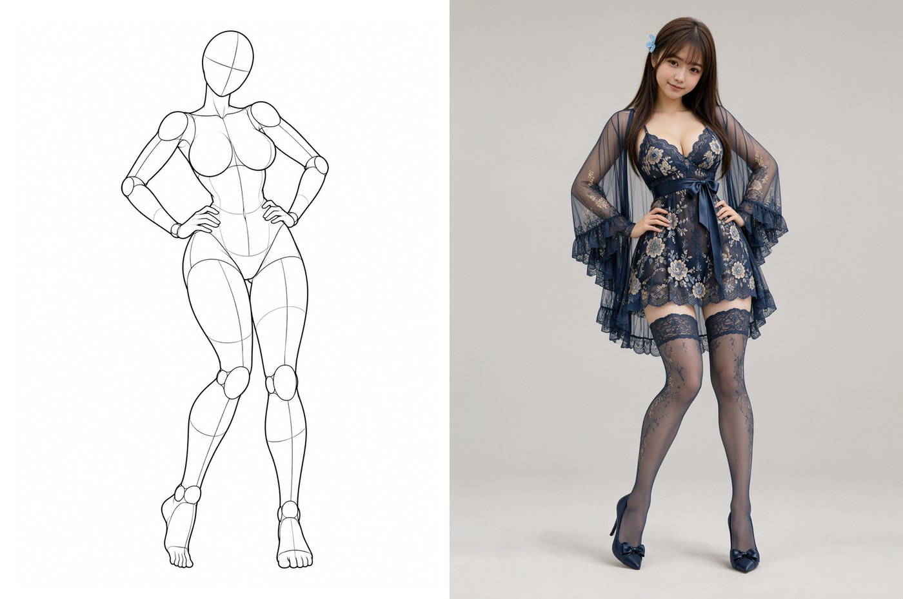 |
| 双手叉腰、正面对称站姿，裙摆层次与落脚点由模型自己补 |

| 薄荷绿猫耳 · 蹲坐 |
| --- |
| 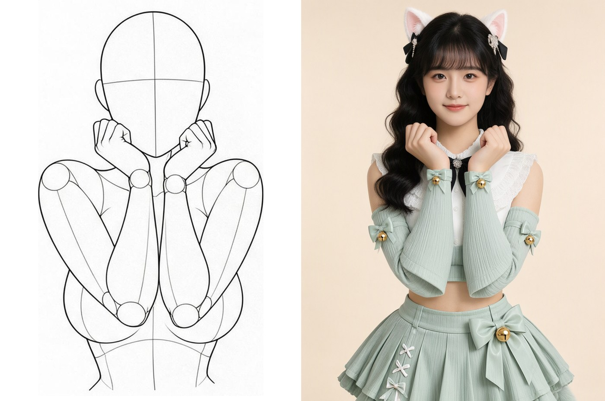 |
| 蹲坐抱膝、双手抵在胸前；猫耳、铃铛、过膝袜都要靠服装参考图带出来 |

### 脸部库 → 身份

| 短发粉挑染特写 → 白红巫女装 |
| --- |
| 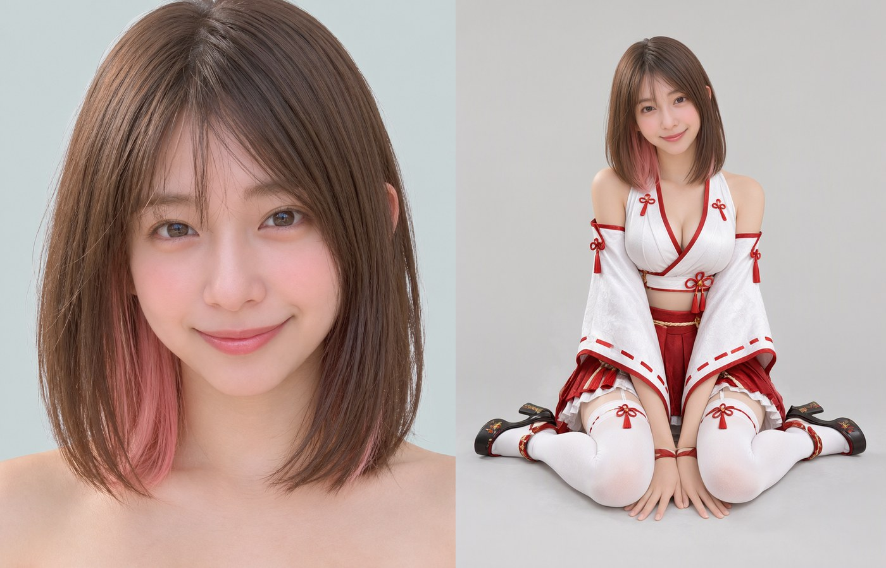 |
| 只给脸与发色，站姿、跪坐与服装全部来自另外两路 |

### 自上传模式 → 换装

| 外部照片当脸 → 白粉猫装 |
| --- |
| 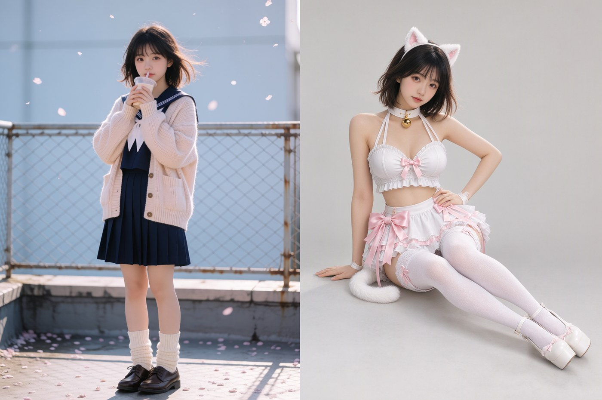 |
| `Fast Muter` 切到自上传，不改连线即可换成真实照片里的身份 |

### 成图

| 星空魔术师 | 深蓝蕾丝 · 举臂 |
| --- | --- |
| 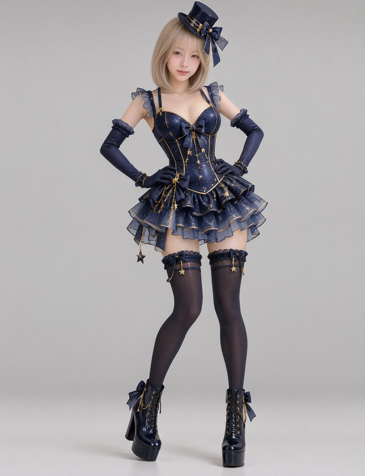 | 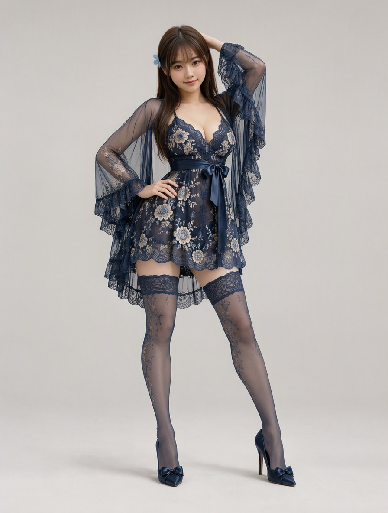 |

| 深蓝蕾丝 · 叉腰 | 薄荷绿猫耳 |
| --- | --- |
| 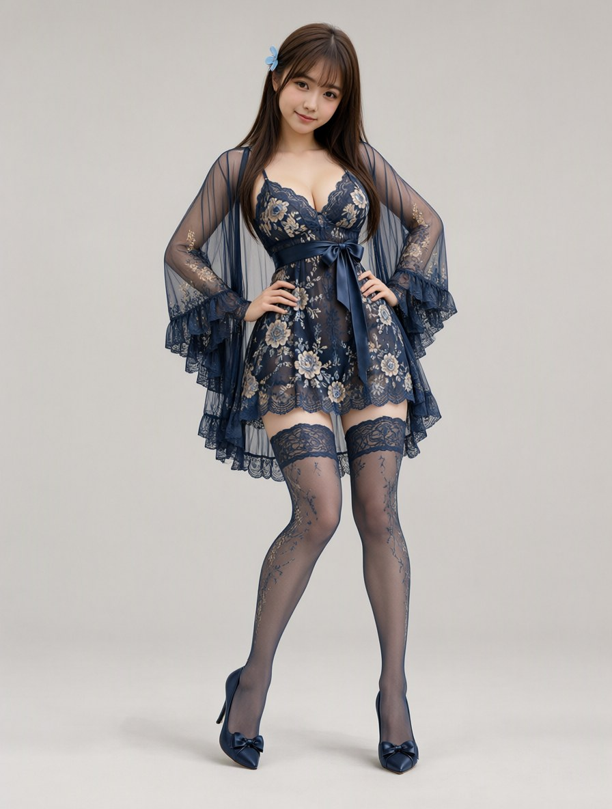 | 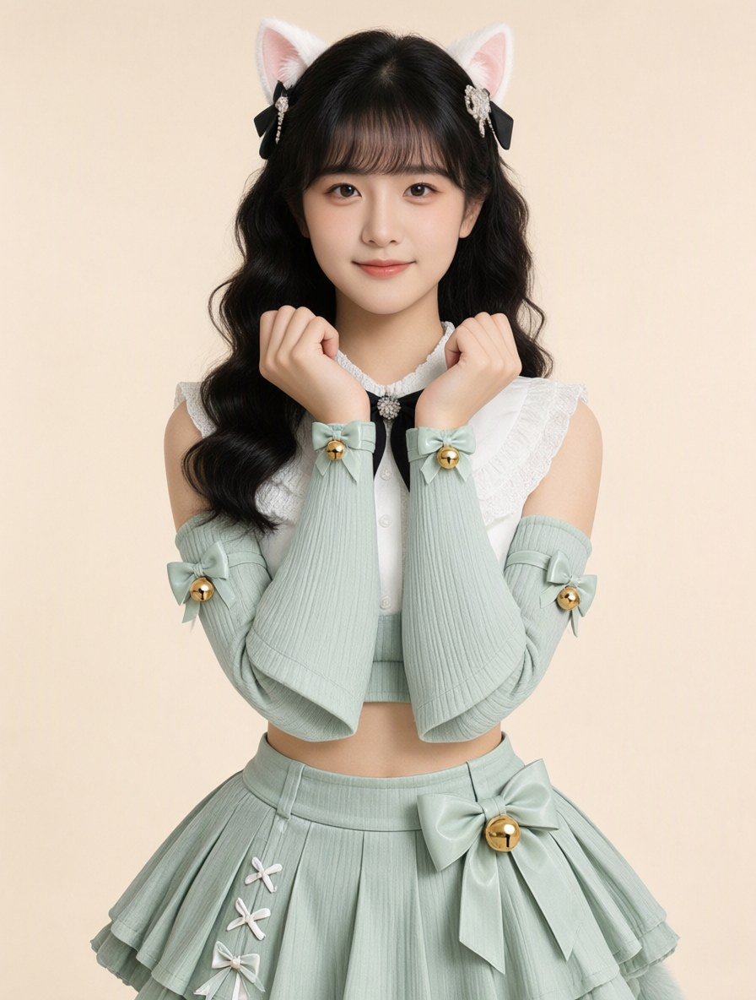 |

| 白粉猫装 | 白红巫女装 |
| --- | --- |
| 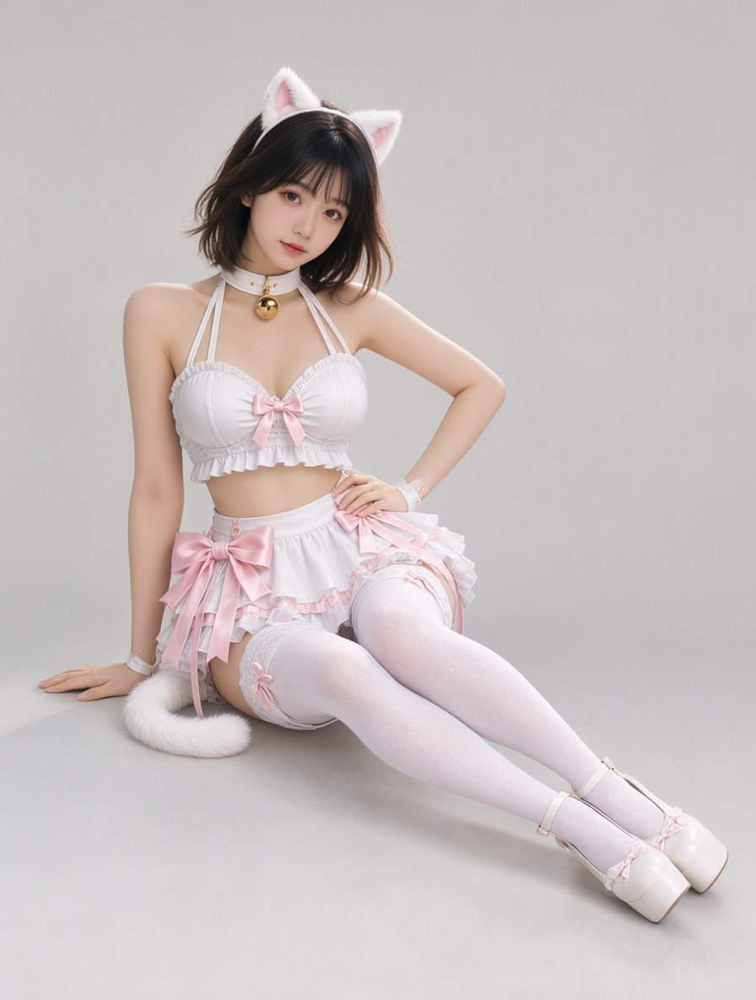 | 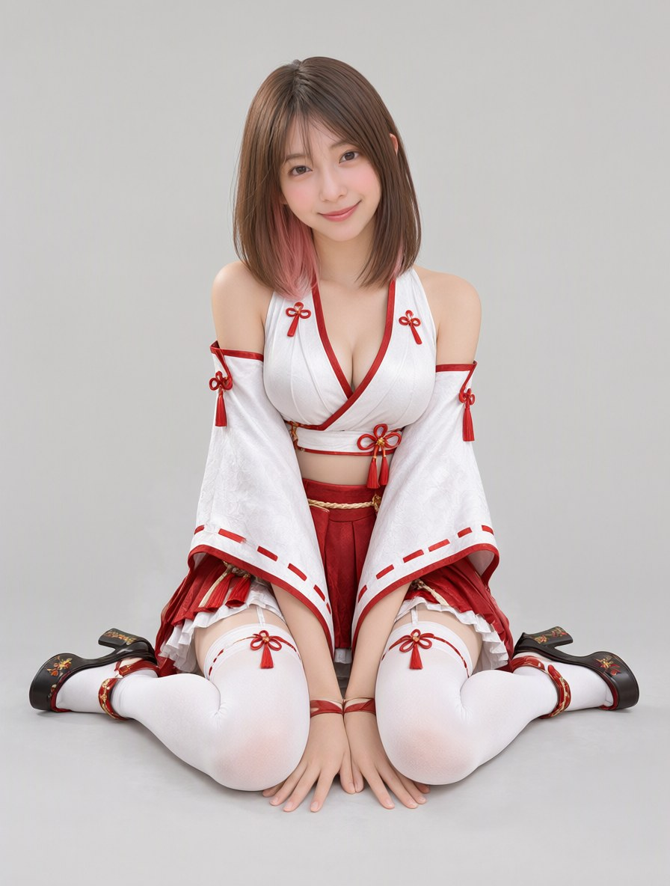 |

## 输出

| 目录（`output/` 下） | 内容 |
| --- | --- |
| `images/qwen2.1/ref_gallery/results/edit` | 成图 |
| `images/qwen2.1/ref_gallery/results/compare` | 参考图 + 成图左右拼接 |
| `images/qwen2.1/ref_gallery/poses/reference` | 所用姿势原图存档 |
| `images/qwen2.1/ref_gallery/faces/reference` | 所用脸部原图存档 |
| `images/qwen2.1/ref_gallery/costumes/reference` | 所用服装原图存档 |

## 效果边界

- 头来自特写、身体来自线稿人偶，脖子与肩线是最容易出问题的地方；脸越大、越正，成功率越高。
- 只适用单人、单套服装。多人姿势（`POS-PAIR-*`）、复杂遮挡需逐张评估。
- 成图尺寸跟随 `image_1` 的比例，约 1 MP。
