# 四库出图 · Qwen Image 2.1

发型、脸、服装、姿势四张参考图合成一张人像，不需要真人照片。**一份 json、两种用法**：上面用四个图库节点各点一次，下面用 `CharacterRecipe` 一个节点四行点完；共用同一套模型加载与采样。画布最上方的「示例开关」点哪组只跑哪组，另一组整组静音，不用手动一个个点。

只依赖本插件、ComfyUI 内置节点和四个模型文件，**不需要 rgthree-comfy 之类的额外插件**。

## 依赖

| 类型 | 需要 | 说明 |
| --- | --- | --- |
| 自定义节点 | 本插件（`comfyui-ref-lookbook`） | 提供四个图库节点与 `CharacterRecipe` |
| 内置节点 | `TextEncodeQwenImage21`、`QwenImage21Cache` | ComfyUI 自带，别装第三方 Qwen 节点包 |
| 模型 | 4 个文件，见下 | 放好后重启 ComfyUI |

| 文件 | 放到 | 大小 |
| --- | --- | --- |
| `qwen_image_2.1_int8_convrot.safetensors` | `models/diffusion_models/` | 6.8 GB |
| `qwen3vl_8b_int8_convrot.safetensors`（类型选 `qwen_image`） | `models/text_encoders/` | 8.7 GB |
| `qwen_image_2.1_vae_bf16.safetensors` | `models/vae/` | 644 MB |
| `VNCCS_QI2_PoseStudioV2.safetensors` | `models/loras/` **根目录** | 152 MB |

LoRA 是 AHEKOT 的 VNCCS PoseStudio Qwen Image 2.1 v2.0：[Civitai](https://civitai.com/models/2957080/vnccs-posestudio-qwen-image-21) 或 [HuggingFace](https://huggingface.co/MIUProject/VNCCS_PoseStudio_QI2.1)（HF 文件名尾带空格，下载后去掉）。必须放 `loras/` 根目录，不能建子目录——Windows 下子目录路径是反斜杠，工作流里写的是正斜杠，会匹配不到。

## 两种用法

| 分组 | 取素材方式 | 提示词 | 适合 |
| --- | --- | --- | --- |
| ① 单独节点（画布上方） | 发型 / 脸部 / 服装 / 姿势 四个节点各点一次 | 写在编码器里，已按四张参考分好工 | 想逐张换、逐张对比 |
| ② 四合一配方（画布下方） | `CharacterRecipe` 四行点完 | 节点按素材拼好中文，自动连进编码器 | 常规出图 |

## 选跑哪一组

两条链各自成组，直接点运行会两条一起跑、白等一半时间。画布最上方有个「示例开关」，两个按钮：

| 按钮 | 效果 |
| --- | --- |
| ① 单独节点取图 | ① 组 `mode=0` 照常跑，② 组整组静音（`mode=2`，不执行也不向下游透传） |
| ② 四合一配方 | 反过来 |

- **单选**：点哪组只开哪组。再点当前已在跑的那组没有反应，所以不会出现两组全关、运行报「没有输出」的情况。
- **默认只跑 ①**。json 里 ② 组本身就存成静音，即使前端脚本没加载也会是这个状态。
- **状态随工作流存盘**：按钮灰底写「已静音」、绿底写「运行中」，右下角一眼看出当前跑哪条。
- 开关节点只认分组标题里的 ① / ②，改分组标题会失效；不想用它，也可以框选一组按 `Ctrl+M` 手动静音，效果一样。

开关是插件自带的前端节点，不进 prompt、不占显存，也不在节点库里单独列出（它是给这份工作流配套的，手动加没意义）。

两条链的输出目录不同（见文末），同一次运行互不覆盖。

## 参考图顺序固定，不能交换

| 端口 | 单独节点 | 配方输出 | 给什么 |
| --- | --- | --- | --- |
| `image_1` | 姿势图库 | `pose_image` | 动作、四肢位置、身体朝向、机位与构图 |
| `image_2` | 脸部图库 | `face_image` | 身份、脸型、五官、肤色 |
| `image_3` | 服装图库 | `costume_image` | 服装、配饰、颜色、材质与层次 |
| `image_4` | 发型图库 | `hair_image` | 头顶造型：长短、刘海、分缝、发色 |

`image_4` 与 `image_2` 会打架：脸部参考本身带着头发。工作流的提示词里写明「发色与刘海以 Image4 为准，覆盖 Image2 的发型」，实测能压住；如果两张差得太远（比如脸是爆炸头、发型参考是齐肩直发），模型会折中成第三种发型——这时把脸换一张接近的，或者干脆不接 `image_4`。

## 发型库两个来源

`Hair Gallery` 的 `hair_source` 下拉切换，配方节点的发型槽也一样：

- **澪设计**：6 卷 54 件，每件带作者写好的中英文提示词。配方节点会把作者那句并进【发型细节】，比索引关键词准得多。
- **二次元**：230 条动漫头型，只有关键词，量大但需要自己在 `extra_prompt` 里补细节。

切来源后编号若不是该来源的形态会自动回落（`H-01-01` ↔ `ANE-H001`），不用手动改。两个来源的浏览页面也不一样：澪设计直接落到 `#s-hair` 系列，二次元落到「发型与眼睛」分类。

## 用自己的照片当脸

画布右上有一张空的 `Load Image`（不接任何线就不会执行）。把自己照片放进去，然后把编码器 `image_2` 上那根来自 `Face Gallery` 的线拖到它上面即可，其余不动。

上一版用 `Fast Muter` 在两个来源之间一键切换，那需要 rgthree-comfy；为了这份 json 不再依赖第三方插件，切换改成拖一根线。拖动一次就固定下来，日常用不到。

## 提示词

两条链都是中文提示词，想改直接在节点里改。

单独节点那条链由 `Prompt Join 提示词拼接` 汇成两段：上面是写在节点里的中文分工说明（图 1 姿势 / 图 2 脸 / 图 3 服装 / 图 4 头发），下面自动接上所选发型的文字描述（发型节点的 `hair_detail`，例如「深棕长发过胸，中分，层次发尾向内收成内扣弧度，柔和丰盈」）。断掉这条线就退回编码器里的兜底文案（同一份中文模板）。

配方那条链把 `prompt_zh` 连进编码器的 `prompt`，内容由节点拼：

```
参考图合成一张完整的角色立绘：{风格}。四张图分工固定——图1 姿势与构图、图2 长相、图3 服装、图4 头发，冲突时以分工为准。
【发型·只认图4】{发型分类：关键词}。把人物头顶的头发整体换成图4 的样子：长度、层次、发尾走向、发色、刘海、分缝都照它；图2 自带的头发一律不要。图4 里的白色人台、脖子、纯色背景不要画进来。
【人像·图2 只取长相】{脸部分类：关键词}。
【服装·图3】{服装分类：关键词}。
【动作与构图·图1】{姿势分类：关键词}。
【发型细节】{澪设计作者写的发型描述}。
【补充细节】{extra_prompt}。
要求面部自然生动，服装贴合身体动态，肢体透视与手部结构准确，光影统一。
```

### 为什么发型要写进提示词

图 4 是一张发型照（澪设计那批是白色人台上的假发），模型只看到一张「物品图」时，权重压不过图 2 那张带头发的人像。表现就是：**选短发立刻生效，选另一个长直发却看不出区别，甚至画回图 2 的卷发**。所以这一版把发型的文字描述（发尾走向、层次、分缝）同时塞进提示词，等于给了「图 + 字」两路证据。手工搭链时如果发型老是不生效，先确认这一段文字在提示词里。

三条路可切：

| 要什么 | 怎么做 |
| --- | --- |
| 中文提示词（默认，细节最全） | 保持 `prompt_zh` → `prompt` 这条线 |
| 英文提示词 | 把线改接 `prompt_en`，风格、服装、发型走英文，脸与姿势交给参考图 |
| 完全手写 | 断掉这条线，在编码器里自己写 |

`prompt_en` 少一截细节不是 bug：脸部与姿势索引没有英文词条，硬把日文塞进英文 prompt 会让模型更糊涂，所以那部分直接省略。实测英文版能把姿势、服装、光位都对上，但发色这类细节需要自己在 `extra_prompt` 或英文 prompt 里补。

## 参数

| 参数 | 取值 | 说明 |
| --- | --- | --- |
| 采样 | 25 步 / CFG 1 / euler / simple | Qwen 2.1 的编辑流程不做 CFG，别调高。**CFG = 1 时负面提示词完全不起作用**，所以这次的发型约束全写在正面提示词里 |
| 种子 | 固定值 | 换图靠改素材而不是改种子 |
| LoRA 强度 | 1.0 | `VNCCS_QI2_PoseStudioV2` |
| 配方 `resize_mode` | 指定尺寸（居中裁剪） | 四张参考先统一到 896×1152 再进编码器 |
| 配方 `width` / `height` | 896 / 1152 | 成图尺寸由 `image_1` 的比例决定，实际约 1 MP |
| 单独节点 `resize_mode` | 原图尺寸 | 四张各按原比例进编码器，成图比例跟随 `image_1` |
| `pose_angle` | 正面 | 姿势五个机位：正面 / 俯视 / 仰视 / 侧面 / 斜 45° |
| `flip_pose_horizontal` | 否 | 只翻姿势图，人物朝向跟服装、脸不一致时用它对齐 |

## 切库与尺寸

| 想换什么 | 改哪个参数 |
| --- | --- |
| 发型来源 | `hair_source`：澪设计 / 二次元 |
| 写实衣服 ↔ 动漫画风衣服 | `costume_library`：`costume` / `costume-anime`（编号规则一致，同一编号在两个库里是两张不同的图） |
| 姿势机位 | `pose_angle`：正面 / 俯视 / 仰视 / 侧面 / 斜 45° |
| 人物朝向 | `flip_pose_horizontal`：只翻姿势，不翻脸和服装 |
| 出图比例 | `resize_mode` + `width` / `height`；选「原图尺寸」时四张按各自原图进编码器 |

三个开关同时改的组合也测过：`costume_library=costume-anime` + `use_depth=true` + `flip_pose_horizontal=true` + 留白填充 768×1024，参考整图如下（服装换成动画人台、姿势换成深度图、人物朝向已镜像）：

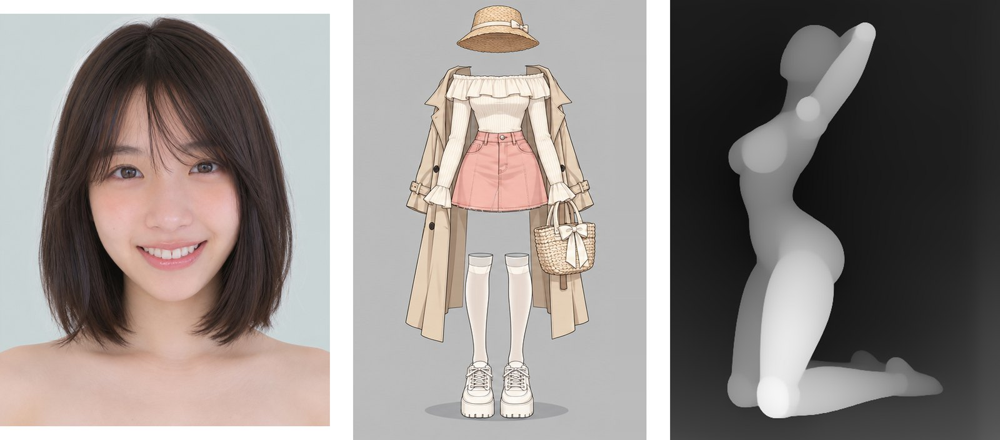

## 深度模式怎么用

配方节点打开 `use_depth` 后姿势槽自动改读深度库（`POS-` → `DEP-`），`pose_image` 换成灰度深度图。**深度图不适合直接当 Qwen 的视觉参考**，模型会把它读成白色人体结构（见下方对比图）。深度姿势库的正确用法是接 ControlNet：

```
DepthGallery.image → ControlNetApplyAdvanced.image → KSampler.positive
```

本工作流没有内置这一路，因为它需要额外的 Qwen Image ControlNet 模型（本机没有，也就不假装能跑）。要做深度控姿态，另起一条 ControlNet 支线，把 `pose_image` 连过去即可。单独节点那条链把 `Pose Gallery` 直接换成 `Depth Gallery` 也行——两者编号一一对应（`POS-SEXY-P031` → `DEP-SEXY-P031`），其余接线不动。

## 效果

四库组合，每组左侧是送进工作流的参考，右侧是成图。

| 线稿人偶 + 脸 + 服装 → 成图 | 自上传照片当脸 → 成图 |
| --- | --- |
| 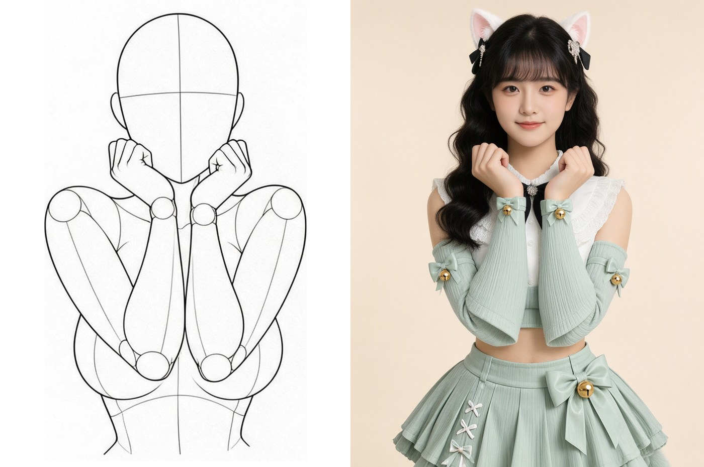 | 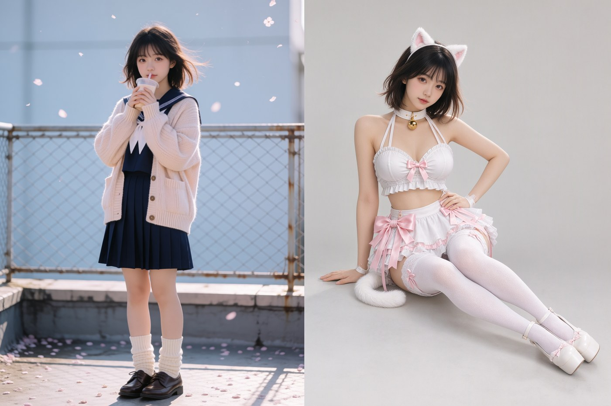 |

### 姿势库 → 动作

| 深蓝蕾丝 · 举臂 |
| --- |
| 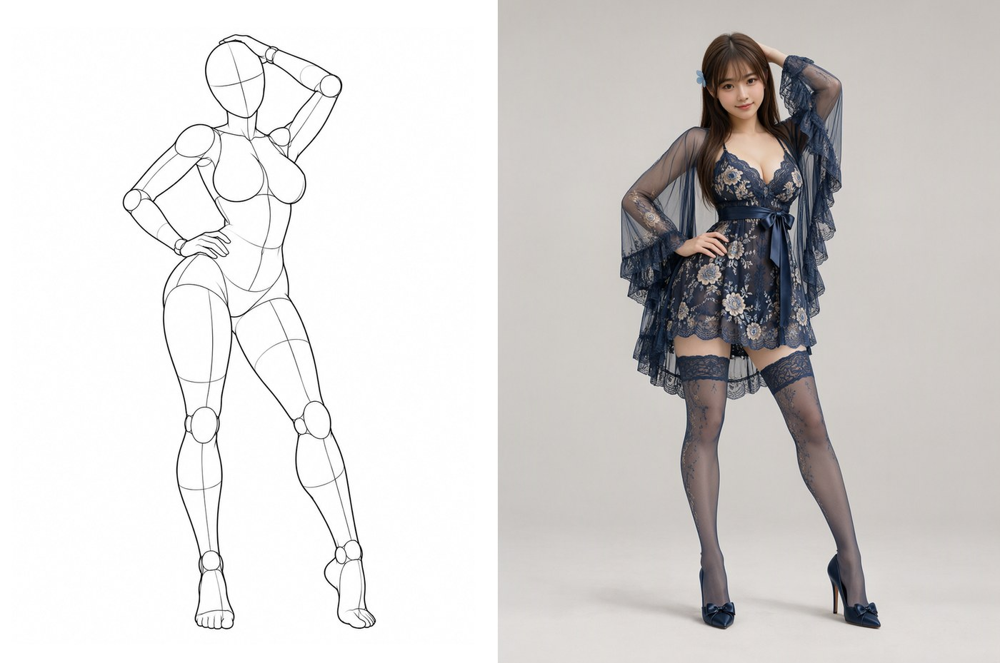 |
| 一手举过头顶、躯干微侧，线稿只定动作与机位，发饰与裙型由另外两路补 |

| 深蓝蕾丝 · 叉腰 |
| --- |
| 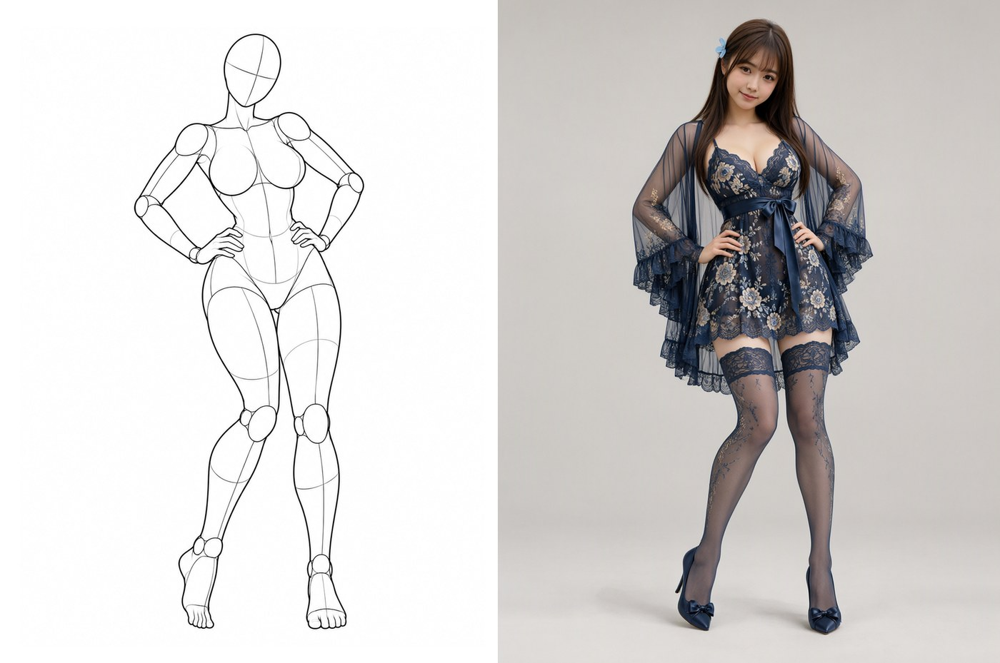 |
| 双手叉腰、正面对称站姿，裙摆层次与落脚点由模型自己补 |

### 脸部库 → 身份

| 短发粉挑染特写 → 白红巫女装 |
| --- |
| 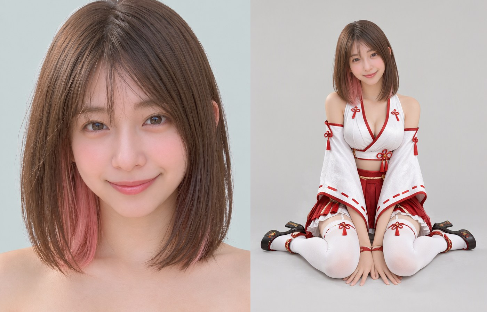 |
| 只给脸与发色，站姿、跪坐与服装全部来自另外两路 |

### 成图

| 星空魔术师 | 深蓝蕾丝 · 举臂 |
| --- | --- |
| 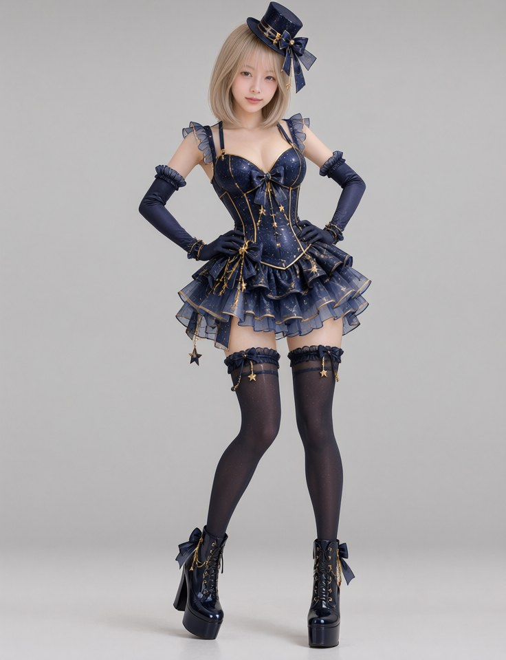 | 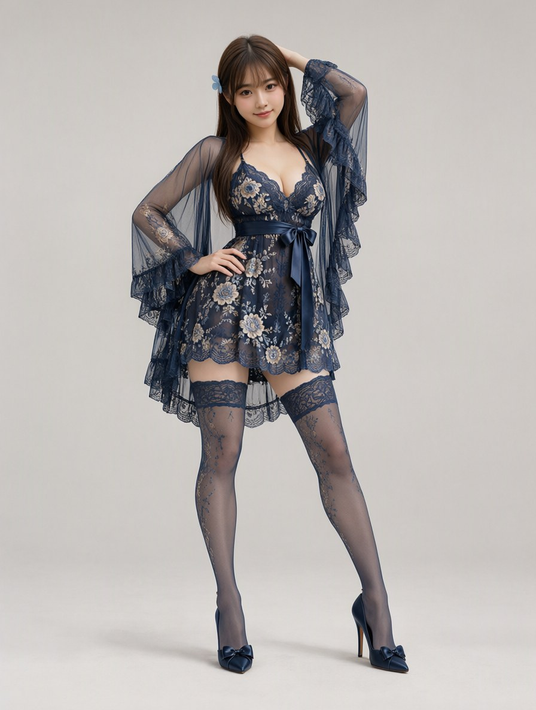 |

| 薄荷绿猫耳 | 白粉猫装 |
| --- | --- |
| 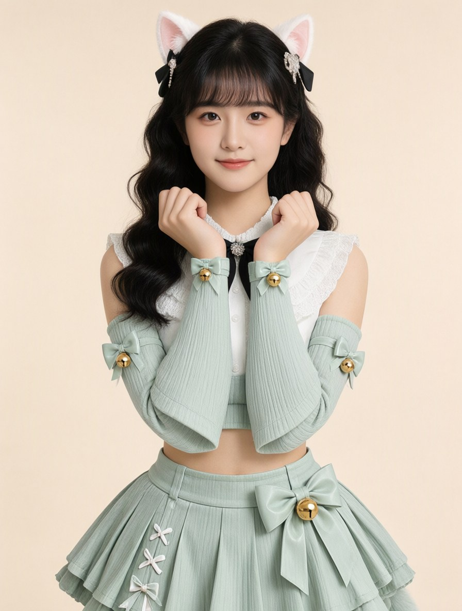 | 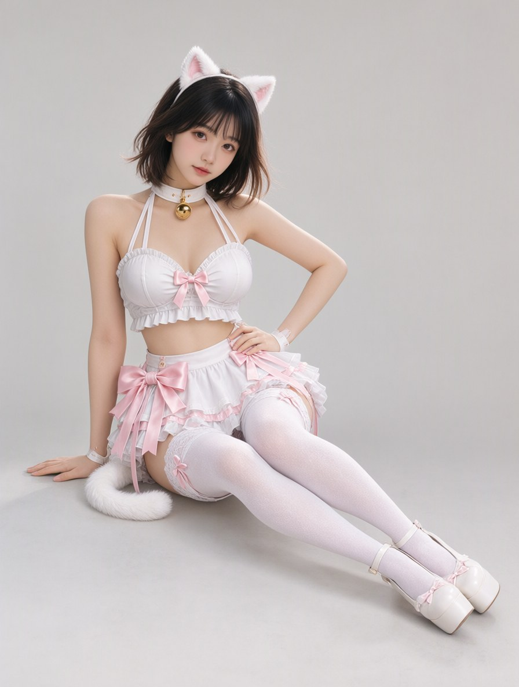 |

### 四合一配方

| 齐肩短发 + 米色风衣粉裙 + 举手扶头叉腰 |
| --- |
| 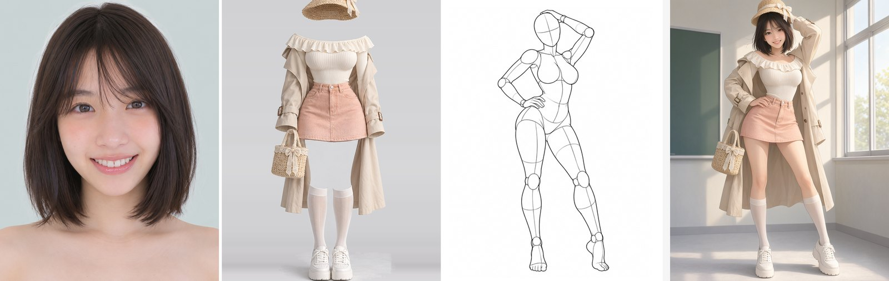 |
| `extra_prompt` 写「银色双眸，教室窗边逆光，微风吹拂发丝」，光位与发色都按描述走 |

| 英文提示词 `prompt_en` | 深度模式 `use_depth` |
| --- | --- |
| 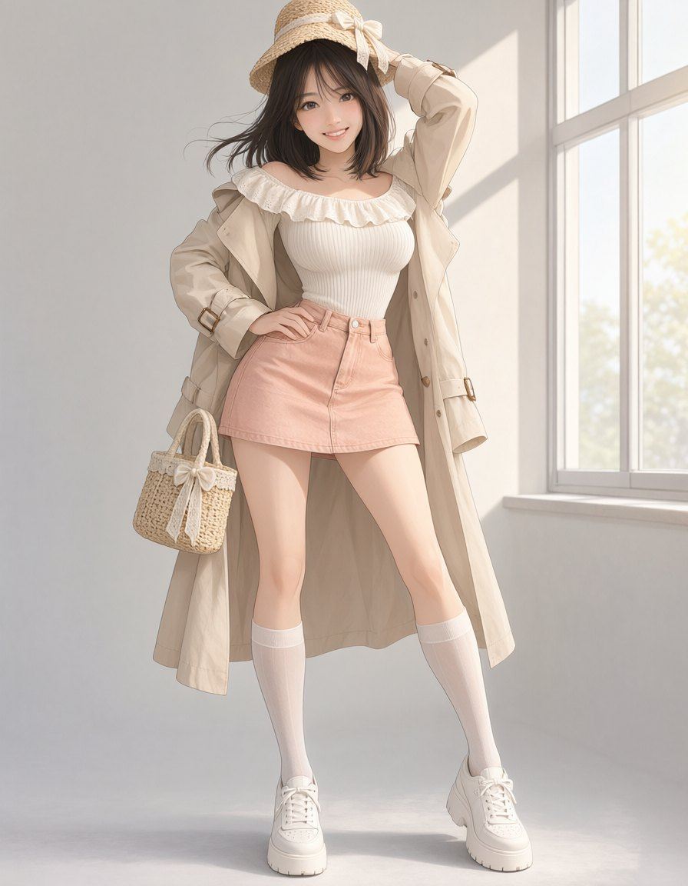 | 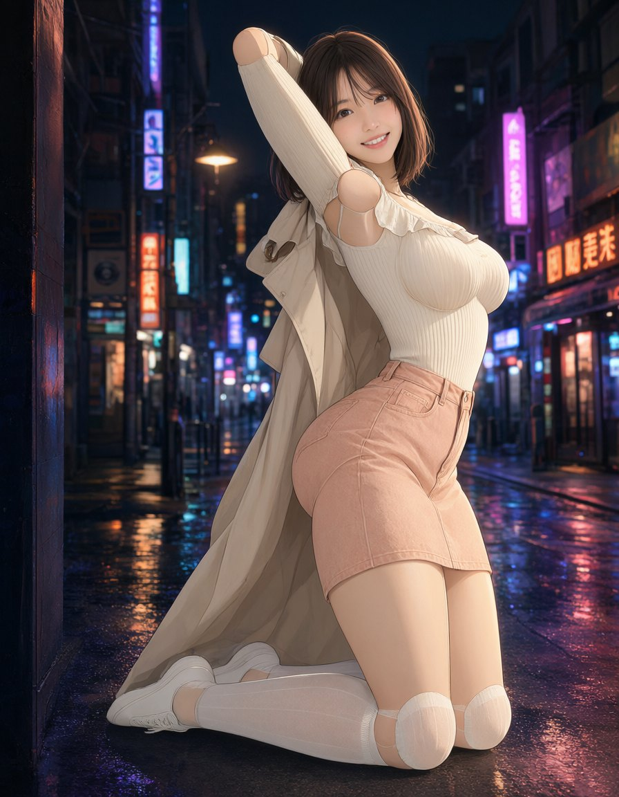 |
| 姿势、服装、窗边光都对上，发色更素——脸部与姿势没有英文词条，细节只能靠自己补 | 姿势对（跪坐抱头）、光影对，但胸前多出一团球状结构：模型把深度图的灰白体积当成实体参考了 |

画布截图（旧版三库组合与三合一配方的截图，新版在此基础上多出 ④ 发型节点与 ② 四合一配方一组，分组位置不变）：

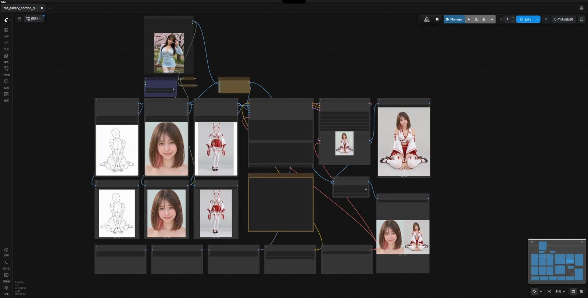

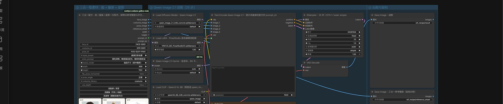

## 输出

| 目录（`output/` 下） | 内容 |
| --- | --- |
| `ref_gallery/single/result` | 单独节点那条链的成图 |
| `ref_gallery/recipe/result` | 配方那条链的成图 |
| `ref_gallery/recipe/reference_sheet` | 四合一参考整图，留档对照 |

## 效果边界

- 头来自特写、身体来自线稿人偶，脖子与肩线是最容易出问题的地方；脸越大、越正，成功率越高。
- 只适用单人、单套服装。多人姿势（`POS-PAIR-*`）、复杂遮挡需逐张评估。
- 线稿人偶的躯干是简化造型，成图胸腰比例会跟着参考走，想改比例就换姿势素材。
- 显存吃紧时把 `QwenImage21Cache` 的 `device` 设成 `cpu`、`dtype` 设成 `int8`，能少占一半 KV 缓存，速度略降。

## 从旧版迁移

`ref_gallery_combo_qwen21.json` 与 `ref_recipe_qwen21.json` 已经并进这一份，两个旧文件不再提供。旧画布上的连线在新文件里对应关系：

| 旧 | 新 |
| --- | --- |
| 三库组合的 `Fast Muter` 脸部来源切换 | 删掉（要装 rgthree），改成把 `image_2` 的线拖到空 `Load Image` |
| 三库组合的姿势 / 脸 / 服装原图存档（`.../poses|faces|costumes/reference`） | 删掉。图库节点本身就在画布上显示选了什么，不再多存一份 |
| 三合一配方的 `ref_recipe/*` 输出目录 | 变成 `ref_gallery/recipe/*` |

配方节点的 `hair_image` 排在输出末尾，就是因为旧工作流的连线按序号存——插到前面会让 `face` / `costume` / `pose` 全部错位一格。旧配方的 json 直接拖进新版本仍然能打开。
