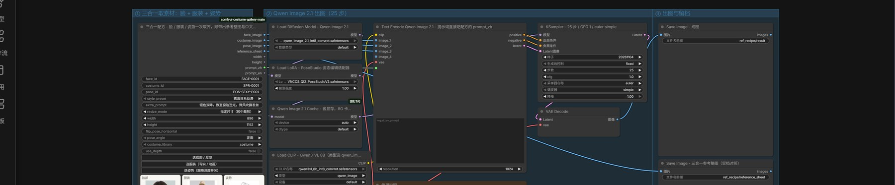
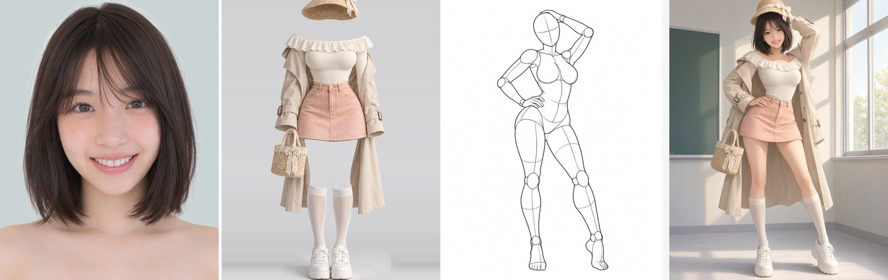
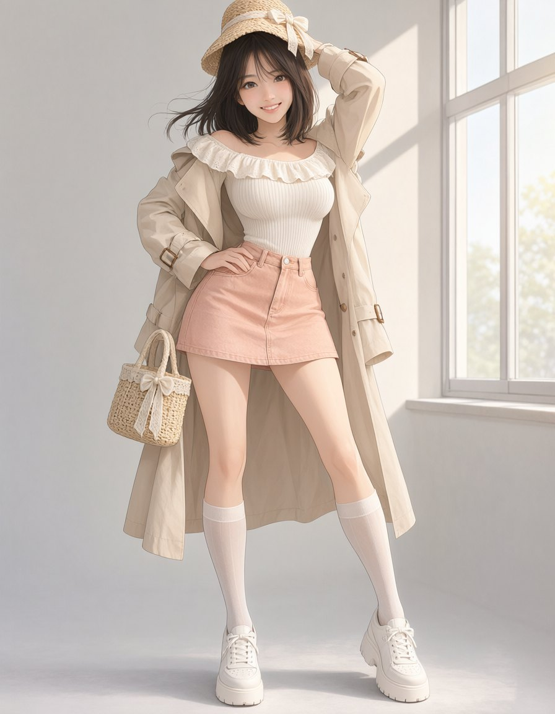
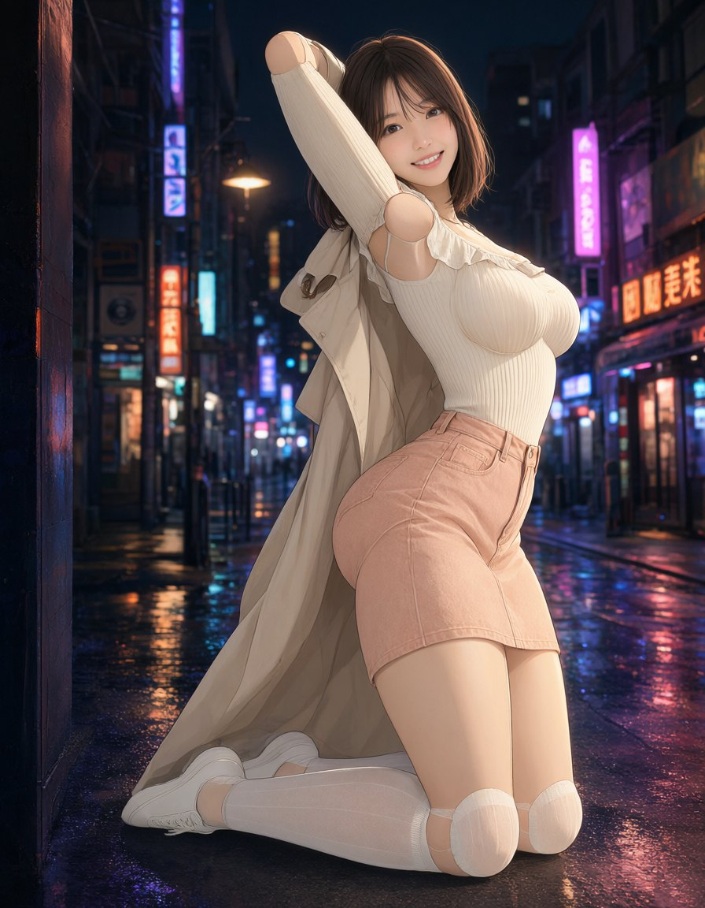
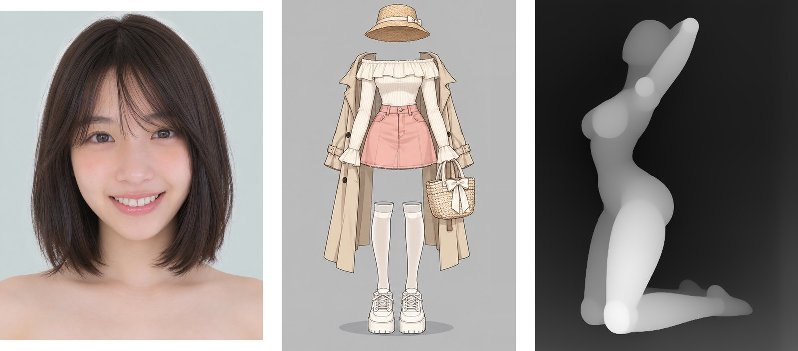

# 三合一配方出图 · Qwen Image 2.1

一个配方节点取齐脸部、服装、姿势，直接喂给 Qwen Image 2.1 出成图。不需要真人照片，也不需要 rgthree 之类的额外插件——只依赖本插件、ComfyUI 内置节点和四个模型文件。



## 和上一版工作流有什么不同

[ref_gallery_combo_qwen21.json](ref_gallery_combo_qwen21.json) 用三个独立图库节点各取一张图，脸部来源靠 `Fast Muter` 手动切，提示词整段手写在编码器里。这一版换成 `CharacterRecipe` 一个节点：

| | 三库组合（旧） | 三合一配方（本版） |
| --- | --- | --- |
| 取素材 | 三个节点分别点三遍 | 一个节点，三行各自点 |
| 提示词 | 手写整段英文 | 节点按素材拼好中文，直接连进编码器 |
| 尺寸 | 原图尺寸，比例各库不一 | `resize_mode` 统一裁切或留白到指定宽高 |
| 参考整图 | 没有 | `reference_sheet` 三张并排，留档对照 |
| 插件依赖 | rgthree-comfy | 无 |

## 依赖

| 类型 | 需要 | 说明 |
| --- | --- | --- |
| 自定义节点 | 本插件（`comfyui-ref-lookbook`） | 提供 `CharacterRecipe` |
| 内置节点 | `TextEncodeQwenImage21`、`QwenImage21Cache` | ComfyUI 自带，别装第三方 Qwen 节点包 |
| 模型 | 4 个文件，见下 | 放好后重启 ComfyUI |

| 文件 | 放到 | 大小 |
| --- | --- | --- |
| `qwen_image_2.1_int8_convrot.safetensors` | `models/diffusion_models/` | 6.8 GB |
| `qwen3vl_8b_int8_convrot.safetensors`（类型选 `qwen_image`） | `models/text_encoders/` | 8.7 GB |
| `qwen_image_2.1_vae_bf16.safetensors` | `models/vae/` | 644 MB |
| `VNCCS_QI2_PoseStudioV2.safetensors` | `models/loras/` **根目录** | 152 MB |

LoRA 必须放 `loras/` 根目录，不能建子目录——Windows 下子目录路径是反斜杠，工作流里写的是正斜杠，匹配不到。

## 用法

1. 下载 [ref_recipe_qwen21.json](ref_recipe_qwen21.json)，拖进 ComfyUI 画布。
2. 配方节点三行各点按钮选素材：**脸** 决定长相发型，**服装** 决定穿着，**姿势** 决定动作构图。
3. `style_preset` 选风格（日系动漫 / 写实摄影 / 韩系半厚涂 / 角色设定图），`extra_prompt` 补细节。
4. 点运行。

参考图顺序固定，不能交换：

| 端口 | 来源 | 给什么 |
| --- | --- | --- |
| `image_1` | `pose_image` | 动作、四肢位置、身体朝向、机位与构图 |
| `image_2` | `face_image` | 身份、脸型、五官、发型与发色 |
| `image_3` | `costume_image` | 服装、配饰、颜色、材质与层次 |

## 提示词从哪来

`prompt_zh` 直接连进 `TextEncodeQwenImage21` 的 `prompt`，内容由配方节点拼：

```
融合参考图生成一张完整的角色立绘：{风格}。
【人像与发型】{脸部分类：关键词}。
【服装】{服装分类：关键词}。
【动作与构图】{姿势分类：关键词}。
【补充细节】{extra_prompt}。
要求面部自然生动，服装贴合身体动态，肢体透视与手部结构准确，光影统一。
```

三条路可切：

| 要什么 | 怎么做 |
| --- | --- |
| 中文提示词（默认，细节最全） | 保持 `prompt_zh` → `prompt` 这条线 |
| 英文提示词 | 把线改接 `prompt_en`，风格与服装走英文，脸部与姿势交给参考图 |
| 完全手写 | 断掉这条线，在编码器里自己写 |

`prompt_en` 少一截细节不是 bug：脸部与姿势索引没有英文词条，硬把日文塞进英文 prompt 会让模型更糊涂，所以那部分直接省略。实测英文版能把姿势、服装、光位都对上，但发色这类细节需要自己在 `extra_prompt` 或英文 prompt 里补。

## 参数

| 参数 | 本版取值 | 说明 |
| --- | --- | --- |
| `resize_mode` | 指定尺寸（居中裁剪） | 三张参考图先统一到 896×1152 再进编码器 |
| `width` / `height` | 896 / 1152 | 成图尺寸由 `image_1` 的比例决定，实际约 1 MP |
| `pose_angle` | 正面 | 姿势五个机位：正面 / 俯视 / 仰视 / 侧面 / 斜 45° |
| `flip_pose_horizontal` | 否 | 只翻姿势图，人物朝向跟服装、脸不一致时用它对齐 |
| 采样 | 25 步 / CFG 1 / euler / simple | Qwen 2.1 的编辑流程不做 CFG，别调高 |
| 种子 | 20261104 | 固定值，换图靠改素材而不是改种子 |
| LoRA 强度 | 1.0 | `VNCCS_QI2_PoseStudioV2` |

## 效果

左三张是配方拼出的参考整图，右边是成图。

| 齐肩短发 + 米色风衣粉裙 + 举手扶头叉腰 |
| --- |
|  |
| `extra_prompt` 写「银色双眸，教室窗边逆光，微风吹拂发丝」，光位与发色都按描述走 |

换素材即换一套结果，连线不用动：

| 英文提示词 `prompt_en` | 深度模式 `use_depth` |
| --- | --- |
|  |  |
| 姿势、服装、窗边光都对上，发色更素——脸部与姿势没有英文词条，细节只能靠自己补 | 姿势对（跪坐抱头）、光影对，但胸前多出一团球状结构：模型把深度图的灰白体积当成实体参考了 |

## 深度模式怎么用

打开 `use_depth` 后姿势槽自动改读深度库（`POS-` → `DEP-`），`pose_image` 换成灰度深度图。前面那张对比就是实测结果：**深度图不适合直接当 Qwen 的视觉参考**，模型会把它读成白色人体结构。深度姿势库的正确用法是接 ControlNet：

```
DepthGallery.image → ControlNetApplyAdvanced.image → KSampler.positive
```

本工作流没有内置这一路，因为它需要额外的 Qwen Image ControlNet 模型（本机没有，也就不假装能跑）。要做深度控姿态，另起一条 ControlNet 支线，把 `pose_image` 连过去即可。

## 切库与尺寸

| 想换什么 | 改哪个参数 |
| --- | --- |
| 写实衣服 ↔ 动漫画风衣服 | `costume_library`：`costume` / `costume-anime`（编号规则一致，同一编号在两个库里是两张不同的图） |
| 姿势机位 | `pose_angle`：正面 / 俯视 / 仰视 / 侧面 / 斜 45° |
| 人物朝向 | `flip_pose_horizontal`：只翻姿势，不翻脸和服装 |
| 出图比例 | `resize_mode` + `width` / `height`；选「原图尺寸」时三张按各自原图进编码器，成图比例跟 `image_1` |

三个开关同时改的组合也测过：`costume_library=costume-anime` + `use_depth=true` + `flip_pose_horizontal=true` + 留白填充 768×1024，三联参考如下（服装换成动画人台、姿势换成深度图、人物朝向已镜像）：



## 输出

| 目录（`output/` 下） | 内容 |
| --- | --- |
| `ref_recipe/result` | 成图 |
| `ref_recipe/reference_sheet` | 三合一参考整图，留档对照 |

## 效果边界

- 头来自特写、身体来自线稿人偶，脖子与肩线是最容易出问题的地方；脸越大、越正，成功率越高。
- 只适用单人、单套服装。多人姿势（`POS-PAIR-*`）、复杂遮挡需逐张评估。
- 线稿人偶的躯干是简化造型，成图胸腰比例会跟着参考走，想改比例就换姿势素材。
- 显存吃紧时把 `QwenImage21Cache` 的 `device` 设成 `cpu`、`dtype` 设成 `int8`，能少占一半 KV 缓存，速度略降。
